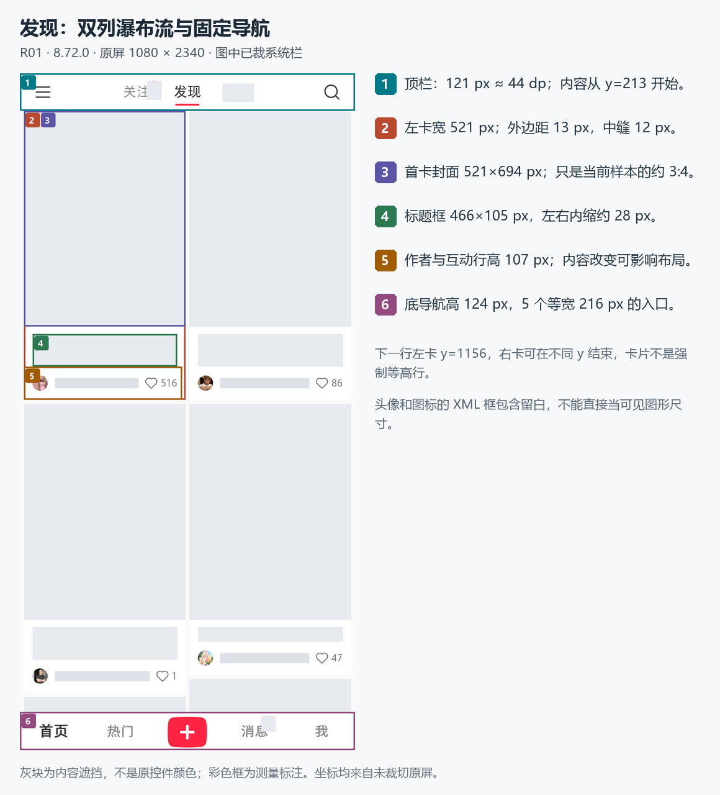

# 帖子软件排版与逻辑

移动端帖子产品的排版、页面逻辑、手势动效与客户端机制研究库，为后续独立实现提供可以追溯的设计输入。

当前样本为小红书 Android 手机端的非购物功能。真机基线是魅族 21 上的 **8.72.0**，**9.49.1 仅做局部静态对照**。这是研究资料库，尚未包含可运行的复刻 App，也不代表整个产品已经研究完成。

## 从这里开始

| 你要解决的问题 | 阅读入口 |
|---|---|
| 先了解本轮成果、版本与边界 | [研究总览](docs/深度研究/00-深度研究阅读入口.md) |
| 我的页面、设置和编辑背景怎样排版 | [第九轮结果](docs/模拟器补测/第九轮/00-本轮结果.md)：头部吸顶、三张编辑卡片、设置返回、两个背景入口与权限空态；含42项节点几何和静态选择配置 |
| 9.49.1 与 8.72.0 的背景链差异 | [新版静态对照](docs/新版研究/08-9.49.1静态对照.md) · [脱敏证据索引](docs/新版研究/08-9.49.1静态对照.json)：V2/旧链共存、选图参数、linker 结构变化与运行时未知边界 |
| 连续操作和转场中断表现怎样 | [第八轮结果](docs/模拟器补测/第八轮/00-本轮结果.md)：图集未翻完即反向、面板与视频分层退出、六组返回位置对照及终态像素核验 |
| 图集边界和视觉层次补到了什么 | [第七轮结果](docs/模拟器补测/第七轮/00-本轮结果.md)：图集边界形变、列表与面板的手势交接、分阶段转场、输入层遮罩及返回位置对照 |
| 窄屏重进和多图评论测到了什么 | [第六轮结果](docs/模拟器补测/第六轮/00-本轮结果.md)：两次窄屏重进、置顶带图长评论状态差异、真实8图评论及异常边界 |
| 上轮长评论与单图的基线 | [第五轮结果](docs/模拟器补测/第五轮/00-本轮结果.md)：长评论收展与状态保留、动态改宽、单槽图片裁切及未完成对照 |
| 最新无手机研究补到了什么 | [第四轮结果](docs/离线补全/第四轮/00-本轮结果.md)：评论宽度缓存、图片圆角与裁切、总数角标及长文本误用排除 |
| 字号档位、品牌字重与评论缩进怎么选 | [第三轮结果](docs/离线补全/第三轮/00-本轮结果.md)：字体条件、尾部换行与图片尺寸分支 |
| 窗口改变和重新进入是否相同 | [第二轮结果](docs/离线补全/第二轮/00-本轮结果.md)：窗口来源、字体默认与覆盖、18 个新增模拟器观察 |
| 卡片、顶栏、评论、筛选怎么排版 | [排版报告与标注图](docs/深度研究/排版/layout-findings.md) · [84 项尺寸表](docs/深度研究/排版/measurements.md) |
| 帖子与页面之间怎么切换、保存状态 | [页面状态机与复刻规格](docs/02-页面状态机与复刻规格.md) · [30 条交互规格](docs/新版研究/05-滑动与导航复刻规格.md) |
| 滑动、转场和页码渐隐怎么做 | [5 段录像的逐帧分析](docs/深度研究/动效/motion-findings.md) |
| 图片加载、列表复用、状态更新的机制 | [客户端机制与新版局部对照](docs/深度研究/机制/core-findings.md) |
| 开始独立实现时采用哪些参数 | [参数与 16 个验收场景](docs/深度研究/01-复刻参数与验收.md) · [参数 JSON](docs/深度研究/复刻参数.json) |
| 还有哪些地方需要补测 | [覆盖与待补测](docs/新版研究/06-实测覆盖与待补测.md) |
| 暂时没有手机时如何继续 | [开发规则与历史差异](docs/离线补全/01-开发规则与历史差异.md) · [16 项补测执行表](docs/离线补全/03-真机补测执行表.md) · [模拟器可用性](docs/离线补全/04-模拟器可用性与测试边界.md) |
| 安装包里有哪些可复用的手势与动效线索 | [第十一轮静态手势与动效](docs/离线补全/第十一轮/00-安装包静态手势与动效.md)：拖拽退出吸附、评论面板嵌套交接、返回边缘手势与 9.49.1 资源差异 |
| GitHub 候选资料是否值得收集 | [8 个候选的筛选记录](docs/外部资料/01-GitHub资料筛选.md)：仅保留 2 条待核实定位线索，未新增原 App 实测参数 |

建议依次阅读“研究总览 → 参数与验收 → 对应排版/动效 → 具体证据”。开发时使用自己的名称、内容、图片与服务端数据，原 App 截图用于研究对照。

## 已有资料

- 12 张源屏支持 84 项几何指标、12 组颜色采样、4 段文字光栅记录和 6 张排版标注图。
- 5 段录屏分析：图集与页码、详情进入/退出、视频评论面板展开/收起。提供采样时间、曲线拟合和测量限制。
- 77 份同版/新版静态机制证据：51 次方法查询中 50 个可用方法体；与早期静态研究分别索引。
- 无手机第二轮另增 55 份同版静态 Evidence、20 份独立辅助解析，以及 18 个有效模拟器观察。发现动态改宽与重新进入详情的图集高度更新不同；新增材料单独索引，不并入旧版计数。
- 无手机第三轮另增 81 份同版静态 Evidence 和 20 份辅助解析。111 条字体表记录逐项对照原始指令；普通评论布局与旧 R06/R19 几何一致。没有新增运行观察，不增加完整用例覆盖。
- 无手机第四轮精选 37 份同版 Evidence、18 份辅助解析与 2 份条件表，补齐评论测量宽度、图片尺寸缓存、总数角标、6dp 图片圆角与居中裁切默认。长评论阈值仍未知；33 个重复/无关/失败探索件仅本地保留，新增运行观察为 0。
- 模拟器第五轮从 52 次采集中选入 35 条脱敏摘要，验证两条长评论收展与部分返回状态；一条动态改宽后重排，关面板重开后恢复折叠。横图裁切与约 10px 圆角有单样本像素拟合；2/3/4+ 图仍缺样本，窄屏详情重进对照未完成。设置已恢复，不增加完整用例数。
- 模拟器第六轮从51次采集中选入39条脱敏摘要，7段录像共1,914帧完整解码；两次720宽详情重进均成功，但不代表第五轮异常修复。新增作者置顶带图长评论的展开恢复差异，找到查看器总数8的真实多图评论；槽位重叠、裁切和窄屏无效边界作为异常保留，不加入通用复刻尺寸。
- 模拟器第七轮从35次采集中选入34条脱敏观察；29段录像共893帧完整解码，另外1段含联系人菜单只留本地。新增图集首尾局部形变、非顶部下拖只滚内容及到顶后面板退出的序列、面板先落位而视频继续收窄、两层返回、约20%遮罩与约21px面板圆角。首次回首页卡片上移639px，直接重进再返回无位移；作为异常对照，不当作固定规则。稀疏录屏不提供虚假精确时长。
- 模拟器第八轮从38次采集中选入35条脱敏观察，20段615帧完整解码。两次释放式连续反向输入在第二页未完整入屏时折返；快速返回时面板开始退出，上方视频仍可先收窄再放大。六个序列终态截图/层级相同。639px返回位移在翻页、输入、正文滚动和只停留组均出现，两个直接进退组未出现；停留时间未匹配，触发原因未知。本组详情整页横向进退，没有把异常或候选写成通用规则。
- 原 R 系列 89 个有效观察、1 个无效、1 个不完整；新增 T 系列 9 个观察。观察次数不等于完整测试用例数。
- 模拟器第九轮有24次采集尝试、23个完整观察，补充我的页、设置与背景编辑。11段276帧录像完整解码，10组终态对照、8组颜色取样、42项节点几何；同版静态43次请求中41份Evidence、2份错误。直接点头图和编辑背景行均进入旧预览页，相册取消直接回编辑资料；未授予权限、未选图、未裁剪或保存，静态构造参数不当作输出尺寸。
- 9.49.1 静态对照补充 V2 与旧背景链的共存、选图参数字段、V2/edit linker 展开差异及 `banner_image` 回写边界；不把 V2 当作新版新增，不把反编译结构差异当作运行体验变化。
- 28 项机器可读参数或未知项；原 100 项用例仍为 31 项部分覆盖、69 项待测、0 项完整覆盖全部条件。

例如：本机双列卡宽 521px，外边距 13px、中缝 12px；详情进入可先用约 200ms 候选，退出约 300ms；页码淡出像素拟合约 195ms。评论展开仅有末段 91.489ms 可可靠跟踪，**不能将其写成完整展开时长**。



## 证据怎样使用

| 类型 | 含义 |
|---|---|
| 真机观察 / 几何测量 | 对指定版本、设备和当前样本成立 |
| 逐帧观察 / 曲线拟合 | 来自录像 PTS 与编码后的像素，保留采样误差 |
| 静态默认分支 | 安装包中的方法与配置，不证明真机必然执行 |
| 实现建议 | 为独立实现提出的选择，不冒充原 App 源码 |

具体修正也已保留：作者栏目返回时 XML 节点相同但截图有 56px 偏移；搜索中已打开的标题从 `#333333` 变为 `#999999`。异常或证据不足的地方单列，不直接作为复刻规则。

## 目录与校验

```text
docs/                   已整理研究、参数、图示与公开证据副本
provenance.json         公开文件与本地来源的摘要映射
public-manifest.json    本仓库文件的字节数和 SHA-256
tools/verify.mjs         文档链接、JSON、摘要与公开边界校验
PUBLICATION.md          公开副本与原始证据的区别
CHANGELOG.md            本库版本记录
```

使用 Node.js 18 或更高版本，在仓库根目录运行：

```sh
node tools/verify.mjs
```

无需安装第三方依赖。修改资料并复核来源后，可用 `node tools/verify.mjs --write-manifest` 更新仓库清单，再提交 Git。

## 版本与后续

初始研究快照日期为 **2026-10-13**，最新补充日期为 **2026-10-15**。8.84.5.5 的早期静态研究、8.72.0 真机与同版分析、9.49.1 局部静态对照分别记录；新版仍未做手机运行验收。

详情标题/正文的 XML 默认、Token 映射、字号档位、单位和品牌字重分支已恢复；普通评论的默认字体、回复缩进、尾部换行、宽度缓存及图片呈现已有条件表。第五轮的单图与长评论基线之后，第六轮补到窄屏详情重进录屏、带图置顶长评论的不同恢复状态和8图评论样本；第七轮增加图集与列表边界反馈、面板手势交接和分阶段视觉转场；第八轮补释放式反向手势与快速返回、终态恢复和不同停留时间的返回位置对照。通用折叠阈值、展开初始状态原因、正常多图槽位/角标及缓存刷新仍未知；第六轮的549px与反向节点边界不是正常排版默认。后续优先真机持续触摸反向与中断、相同停留时长的返回位移对照、独立查看器及多图异常生命周期对照，再补弱网、草稿、消息/群聊、非交易直播及新版。签名核验、服务端推荐算法和播放器 native 内部仍未完成。

第九轮另补个人页与背景编辑：推荐区消失与主动上滑吸顶分别记录，编辑页浅色三卡结构与设置深色样本分开保存。背景裁剪操作、输出尺寸和保存后刷新仍未测，不能用选择器中的静态字面量补成现场结论。第十轮只做 9.49.1 静态对照，明确两版已有的 V2/选图结构和新版运行时待测项。

公开库包含脱敏后的研究副本；原始手机层级、完整新录屏、安装包和本地 v4 ZIP 留在本地。原静态 Manifest 作为研究证据保留，SDK 元数据值已移除。详情见[公开发布说明](PUBLICATION.md)。
