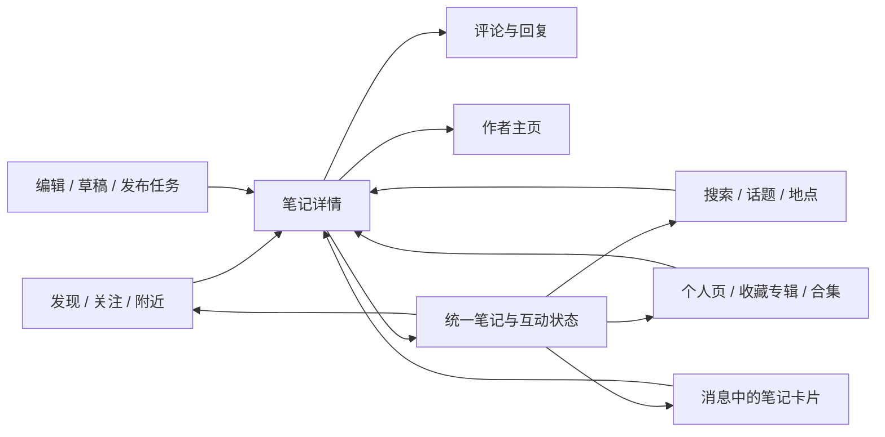
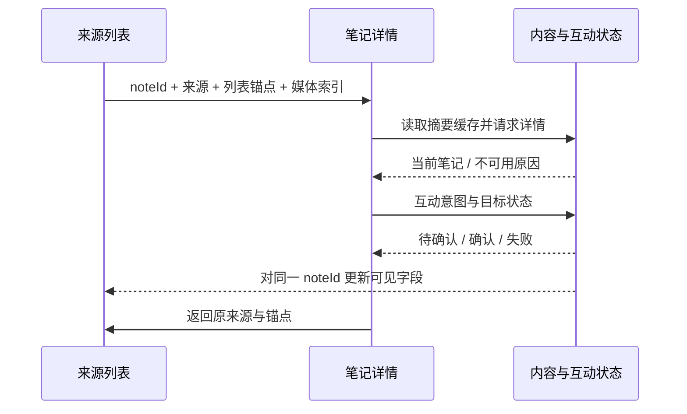
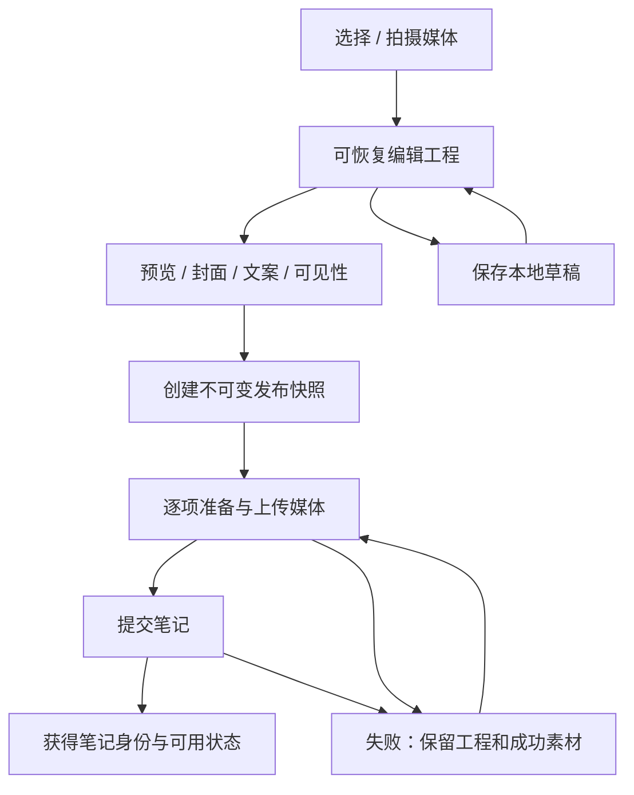

# 手机社区复刻规格：非购物范围

版本：研究交付 v1，2026-10-13。依据：8.84.5.5 Android 安装包与本轮保存的官方手机资料。

后续补充：8.72.0 真机的具体滑动、评论容器、搜索和返回行为已整理为[滑动与导航复刻规格](新版研究/05-滑动与导航复刻规格.md)。本文件仍是整体工程建议；两者不一致时保留版本与证据差异，不把建议冒充实测。

**本文件是后续独立实现的建议契约（C-建议），不是小红书原始协议或已验证的完整状态机。** “应/必须”均约束未来复刻工程；实际小红书是否这样实现，需要以《01-手机端非购物研究报告》的证据和《03-真机补测与验收清单》为准。本轮不开始开发，不选定技术栈，不调用小红书私有接口。

## 1. 产品结构与实现边界

保留内容社区：图文和视频、浏览、搜索、笔记详情、评论、赞藏关、个人页、收藏专辑、发布编辑、草稿、消息、私信、群聊、附近、非交易直播，以及登录、权限、隐私和内容治理。合集、话题、地图、翻译、校园圈、回忆和 AI 等能力保留独立扩展位置。

排除商城、商品搜索、购物车、下单、支付、订单、钱包、付费礼物、带货成交、商业投放。纯内容地点与附近浏览保留；地点页面上的购买、预约成交不纳入。

优先复刻可感知的交互关系和失败处理，再根据手机实测确定精确布局。品牌标识、素材和内容由独立项目提供；安装包里的原始资源仅用于研究，不作为默认产品素材。

图中“统一状态”是复刻建议，原包只证明多种模型和局部差分，并未证明采用了同一全局仓库。导航图是功能关系，不是当前小红书底部标签数量或排序。

## 2. 页面目录

每个页面需要明确入口、上下文、返回位置和访问条件。`Pxx` 是本规格的页面标识。

| ID | 页面 / 区域 | 输入上下文 | 主要事件与出口 | 必须保留的页面状态 | 事实基础 / 原 App 未知 |
|---|---|---|---|---|---|
| P01 | 启动 / 登录 / 授权提示 | 启动目标、登录意图 | 登录成功、取消、稍后、同意/拒绝 | 待恢复的用户意图、目标路由 | 官方账号/权限声明；拦截时机未知 |
| P02 | 发现内容流 | 频道、流实例 | 刷新、下一页、开详情、长按 | 列表顺序、游标、滚动锚点 | C31、M44；列数/排序未实测 |
| P03 | 关注内容流 | 当前用户、关注关系 | 刷新、加载、开主页、开详情 | cursor、hasMore、推荐区状态 | C11、C23、F08 |
| P04 | 附近 / 城市内容 | 定位授权、选定城市、分类 | 选城、筛选、地图、详情 | 城市、位置精度级别、分类 | C12、F11；真实定位拒绝表现未知 |
| P05 | 地图 / 地点信息 | POI 或地图视野 | 选点、开内容列表、开详情 | 视野、选中点、列表锚点 | 官方声明；联动阈值未知 |
| P06 | 图文笔记详情 | noteId、来源、列表上下文 | 翻图、赞藏评、分享、作者、返回 | 图片索引、正文展开、评论锚点 | C01、M04 |
| P07 | 视频笔记详情 | noteId、来源、播放意图 | 播放暂停、拖进度、切笔记、评论 | 进度、静音、手动暂停、清晰度偏好 | C01、自动滚动辅助代码；完整播放器未知 |
| P08 | 图片浏览 / 放大 | noteId、mediaId、原索引 | 缩放、拖动、下一张、返回 | 缩放/平移、当前图 | M06、M37；退出手势未知 |
| P09 | 评论面板 / 评论页 | noteId、目标评论、排序 | 翻页、展开回复、回复、赞、举报 | 根游标、每楼回复游标、输入稿 | C05、C06、C08 |
| P10 | 评论输入 / 媒体预览 | 根评论与回复目标、输入稿 | 编辑、选图、@、发送、重试、取消 | text、附件、目标、上传/发送状态 | C08、M51、M52 |
| P11 | 更多 / 长按菜单 | 对象、角色、能力 | 不感兴趣、举报、隐私、编辑/删除 | 菜单对象与入口，不跨对象复用 | F20—F24、C40；当前选项未知 |
| P12 | 分享面板 | 内容摘要、目标、权限 | 系统分享、复制、发给会话、关闭 | 被分享的对象版本 | F07；回调不等于对方接收 |
| P13 | 搜索入口 / 输入 | 初始词、来源 | 输入、提交、清空、取消、建议词 | inputText、历史、键盘状态 | F10、C13；联想规则未知 |
| P14 | 搜索结果 | query、类别、筛选、排序 | 换标签、下一页、开详情、筛选 | 每组条件各自列表与锚点 | C13 |
| P15 | 搜索筛选面板 | 已提交筛选与临时选择 | 修改、重置、确认、取消 | 临时值与已应用值分开 | C29、M34 |
| P16 | 话题 / 专题内容页 | topicId、来源 | 关注话题、浏览、创作入口 | 内容列表与话题信息 | hashTag 字段、搜索话题声明；完整页未知 |
| P17 | 自己的主页 | 当前用户 | 切栏目、编辑资料、草稿、设置 | 当前栏目及各栏目列表状态 | F18、F19、C18、C19 |
| P18 | 他人主页 | userId、访问身份 | 关注、私信、切栏目、举报 | 栏目、列表锚点、关系状态 | 官方资料与组件声明；权限组合未知 |
| P19 | 资料编辑 | 当前资料、可编辑字段 | 修改、保存、放弃 | 原始值、未保存值、错误 | F18；字段限制与审核未知 |
| P20 | 收藏专辑列表 | 用户、可见范围 | 新建、打开、选择收藏位置 | 列表顺序、选择集 | F09、C53、C55 |
| P21 | 收藏专辑详情 / 管理 | boardId、访问能力 | 加入/移出/移动、编辑隐私、分享 | noteIds、分页、批量选择 | C53；移动/复制、默认隐私需补测 |
| P22 | 作者合集 / 系列 | collectionId、作者资格 | 看列表、顺序观看、管理 | 顺序与播放位置 | C09、C46；入口与创建资格未知 |
| P23 | 发布入口 / 相册 / 拍摄 | source、选图意图、权限 | 拍摄、选择、预览、进入编辑 | 选中媒体与次序 | F02、F03、C44 |
| P24 | 图像 / 视频编辑 | draftId、素材清单 | 裁剪、滤镜、文字、音乐、封面、保存 | 可恢复编辑工程、撤销栈 | C48、C49；原App完整工具与限制未知 |
| P25 | 发布设置 / 任务进度 | 编辑工程、上传结果 | 标题正文、话题、地点、可见性、提交 | 发布稿、任务状态、错误原因 | 官方发布能力、配置对象；提交链未知 |
| P26 | 草稿列表 / 恢复 | 当前用户、本地草稿版本 | 恢复、继续、删除、损坏提示 | 草稿身份、更新时间、素材可用性 | 草稿入口与服务声明；存储未恢复 |
| P27 | 消息中心 / 互动通知 | 当前账号、分类 | 分类切换、开笔记/评论/用户 | 各类未读与分页位置 | F15—F17；聚合口径未知 |
| P28 | 会话列表 | 会话摘要 | 开聊天、搜索会话、静音等候选操作 | 摘要、未读、同步水位 | C50；具体管理选项待实测 |
| P29 | 私信 / 群聊 | conversationId、目标/群、权限 | 发文字/媒体/笔记、引用、撤回候选 | 历史锚点、输入稿、待发消息 | C16、C42、M24；限制与回执未知 |
| P30 | 群资料 / 成员管理 | groupId、当前成员角色 | 成员、邀请、群设置、退出 | 权限与成员列表 | 官方群聊；管理能力逐项待测 |
| P31 | 直播观看 / 非交易互动 | liveId、入口 | 看直播、评论、赞、连麦候选、退出 | 连接、播放、评论、连麦状态 | F25—F27；协议与状态未恢复 |
| P32 | 登录后设置 / 隐私 / 通知 | 当前配置与设备权限 | 修改、保存、系统授权、退出账号 | 保存中/失败、设备与账号设置分离 | F14、F17、F20、F24 |
| P33 | 举报 / 黑名单 / 反馈 | targetType、targetId、理由 | 提交、取消、查看结果 | 提交状态与用户证据 | F20、F21、F28；回执未知 |
| P34 | 长尾能力入口 | capability、实验配置 | 校园圈、翻译、AI、运动、回忆、小组件 | 各模块独立，不复用主帖状态 | 官方候选；当前入口和流程未验证 |

P11—P12、P15 等可能实际是弹层，不要求独立全屏路由。应在真机补测后固定呈现方式。

## 3. 数据契约建议

下列类型名和枚举是独立工程的设计名。不要把观察到的混淆类名、完整 App 对象或私有路径当自己的 API。

| 对象 | 建议最小字段 | 不变量与用途 | 证据基础 |
|---|---|---|---|
| `Note` | id、authorId、kind、title、body、mediaIds、coverMediaId、topicIds、mentions、poiId、visibility、availability、createdAt、updatedAt | 内容身份稳定；媒体与正文可增量更新；不可用不等于对象不存在 | C01、C02 |
| `NoteStats` | noteId、likeCount、collectCount、commentCount、shareCount、version | 数字与显示字符串分开；展示缩写不参与计算；不产生负数 | C01、M46、M48 |
| `ViewerNoteState` | accountId、noteId、liked、collected、boardIds、pendingOperations | 按账号隔离；收藏关系不能由计数推导 | C01、C53、F09 |
| `MediaAsset` | id、kind、width、height、durationMs、sourceRef、previewRef、availability | 保留尺寸以稳定布局；本地路径和远程资源分开 | C01、C48、C49 |
| `UserProfile` | id、displayName、avatar、bio、region、profileFields | 资料显示与资料修改权限分开 | F18 |
| `ViewerUserRelation` | accountId、targetId、followState、blocked、canMessage、version | 当前账号的关系；权限来自权威结果或明确本地规则 | F08、F20 |
| `FeedSession` | sessionId、feedKey、orderedNoteIds、cursor、hasMore、phase、requestVersion、scrollAnchor | 每个频道/条件单独维护；刷新成功才替换旧内容 | C23；其余为建议 |
| `Comment` | id、clientId、noteId、rootId、replyToId、authorId、body、attachments、likeCount、liked、createdAt、availability | rootId 表示归属楼层，replyToId 表示回复对象，二者不能混用 | C08 |
| `CommentThreadPage` | rootId、replyIds、cursor、hasMore、expanded、phase | 每楼独立分页；展开某楼不影响另一楼游标 | C08 |
| `CommentDraft` | draftId、accountId、noteId、rootId、replyToId、text、localMediaIds、phase、error | 关闭面板可保存本地稿；发送成功后再清除 | C08；保存策略为建议 |
| `Board` | id、ownerId、name、description、cover、visibility、memberIds、capabilities、noteCount | 收藏专辑，与笔记收藏状态/作者合集分开 | C53、C55、F09 |
| `BoardMembership` | boardId、noteId、addedAt、orderKey | 移出专辑和取消总收藏分别定义语义 | C53；具体语义需产品确认 |
| `NoteCollection` | id、authorId、title、orderedNoteIds、orderPolicy、capabilities | 作者组织内容的合集/系列；不复用 Board | C09、C46 |
| `SearchSession` | id、inputText、submittedQuery、resultType、appliedFilters、draftFilters、sort、requestVersion、pages | 输入词与查询词分开；应用筛选才生成新查询 | C13、M34；请求版本为建议 |
| `DraftProject` | id、ownerAccountId、schemaVersion、mediaRefs、editOperations、text、cover、visibility、updatedAt、integrity | 可恢复编辑工程；预览图片不能替代工程 | C48、C49；持久化为建议 |
| `UploadTask` | id、localAssetId、status、bytesSent、totalBytes、remoteAssetId、error、cancelRequested | 单素材独立失败与重试；取消与远程清理分开 | M22、M51、M52 |
| `PublishTask` | id、draftId、idempotencyKey、snapshotVersion、status、uploadTaskIds、noteId、error | 一次提交绑定内容快照；重复提交不生成重复笔记 | 后续设计；原App幂等未恢复 |
| `Notification` | id、kind、actorId、target、createdAt、readState | 点击目标失效需可恢复；站内未读与系统推送分开 | F17；具体结构为建议 |
| `Conversation` | id、kind、participantIds、latestMessageId、unreadCount、syncCursor、capabilities | 会话顺序与消息历史分页分开 | C50、C16 |
| `Message` | id、clientId、conversationId、senderId、kind、payload、replyToId、createdAt、serverOrder、sendState、revoked | 客户端身份用于重试去重；撤回使用占位保持顺序 | C16、C42；重试策略为建议 |
| `LiveSession` | liveId、status、streamState、audienceInfo、commentCursor、linkMicState、capabilities | 播放连接与连麦权限分开；不包含交易字段 | F25—F27；状态设计未获原包验证 |
| `CapabilitySnapshot` | accountId、version、enabledFeatures、limits、expiresAt | 没有配置时采用可解释默认；影响当前任务的变更不突然丢稿 | M21、C44；存储与更新策略为建议 |

### 状态分层

- 服务端事实：已提交的笔记、确认后的互动状态、计数、关系、权限、消息身份。
- 账号状态：当前用户对笔记的赞藏、私信和隐私设置；切换账号必须隔离。
- 页面会话：顺序、游标、筛选、展开楼层、图片索引、列表锚点。
- 临时任务：发送中、上传中、失败原因、重试目标、待确认操作。
- 本地编辑：未发布文本、素材引用、编辑工程、恢复信息。

不能用同一个 `loading` 控制整页所有组件，也不能用同一套状态覆盖“首次加载失败”和“有旧内容时下一页失败”。

## 4. 信息流与详情状态机

### 4.1 列表

| 当前状态 | 事件 / 条件 | 下一状态与操作 | 页面表现 |
|---|---|---|---|
| `idle` | 进入流，缺缓存 | `initialLoading`，生成请求版本 | 占位布局，保留导航 |
| `idle` | 进入流，有可用缓存 | `ready`，按策略后台刷新 | 立即显示缓存并标明刷新进度 |
| `initialLoading` | 返回有内容 | `ready`，建立顺序和游标 | 内容区出现 |
| `initialLoading` | 返回空内容 | `empty` | 空态及可行动出口 |
| `initialLoading` | 请求失败 | `initialError` | 局部重试，不要求重启 |
| `ready` / `empty` | 用户刷新 | `refreshing`，保留旧列表快照 | 顶部刷新指示 |
| `refreshing` | 当前版本成功 | 原子替换列表，转 `ready` / `empty` | 不混入旧请求结果 |
| `refreshing` | 失败 | 恢复旧 `ready` / `empty` | 保留已有内容并给重试反馈 |
| `ready` | 到达加载阈值且 hasMore | `loadingMore`，同游标只允许一个请求 | 底部加载 |
| `loadingMore` | 成功 | 按 noteId 去重追加，更新 cursor/hasMore | 稳定已有项目位置 |
| `loadingMore` | 失败 | `appendError`，保留旧列表和原游标 | 底部重试 |
| 任意 | 条件切换 | 新建/恢复对应 FeedSession | 不让另一频道结果覆盖 |
| 任意 | 离开页面 | 保存锚点与状态，取消无用渲染任务 | 之后可恢复 |

原包已确认关注流有 cursor/hasMore（C23）；上表的去重、请求版本及恢复策略均是建议。

`scrollAnchor` 建议包含 `itemId + offsetWithinItem`，必要时附布局版本。仅存像素偏移会在图片尺寸、字号或列表项目变化后漂移。刷新后锚点不存在，应按明确退化规则恢复到邻近项或顶部。

### 4.2 开详情与返回

这是一套建议同步方式。不能将图中消息流当作已观测到的小红书运行调用链。

详情状态：`summaryOnly → loadingDetail → ready / unavailable / error`。详情失败时，如果摘要仍有效，可以保留摘要和重试入口；不以空白整页掩盖错误。内容不可用要区分删除、无权限、审核中候选状态和通用失败，展示取决于独立后端能实际证明的原因。

返回顺序建议：先收起输入法，再关闭当前浮层，再退出媒体浏览，最后离开详情。手势返回、系统返回、顶部返回必须使用一致规则。原 App 的精确优先级需要补测。

### 4.3 图片与视频

图集状态分为 `currentIndex`、`scrollPhase`、`indicatorState`、`zoomState`，切换图片时同步当前索引，吸附结束后发出一次完成事件。多图页码的 200 ms / 5 秒配置可作为**旧版代码参考**；不要把它写成新版本硬性验收常量。

视频建议状态：`idle → preparing → buffering → playing ↔ paused → ended`，任何播放阶段可进入 `error`。生命周期另有 `backgrounded` / `offscreen`，是否恢复播放取决于“用户曾主动暂停”“进入后台前是否播放”和“现在是否仍可见”，不能仅调用页面 resume 就播放。

独立播放器约束：同一时刻只允许定义范围内的一个视频出声；切换笔记、打开相机、开始语音录音时需要协调音频焦点。自动滚动是单独的 `disabled / off / on` 能力，不与当前视频 `playing` 混用。前者三态有 M19 的静态依据，后者协调策略为建议。

## 5. 赞、收藏、关注与评论

### 5.1 二值互动的并发规则

建议为每个 `(accountId, targetType, targetId, action)` 维护 `confirmedState`、`desiredState`、`inFlightVersion`。事件传目标值，不只传“切换”。

| 事件 | 处理约定 |
|---|---|
| 用户点击 | 更新 desiredState；若选择即时反馈，显示为待确认状态 |
| 无在途请求 | 发送目标状态和独立工程的操作身份 |
| 在途再次点击 | 合并最新意图，避免同一对象并行写入导致乱序 |
| 当前请求成功 | 用权威状态/计数确认；若最新意图不同，再发一次 |
| 当前请求失败 | 保留/回滚取决于产品策略，并明确给重试；不得把网络终止事件直接当成功 |
| 过期响应 | 不覆盖较新的意图；仅保留必要诊断 |
| 未登录 | 记录意图后引导登录；登录取消即取消操作；成功后重新校验对象权限 |
| 切换账号 | 停止旧账号渲染与操作回填；使用新账号的 viewer 状态 |

“即时反馈”是复刻可选策略，原包 M12 的样本在请求返回后映射列表；没有证据支持全 App 都乐观更新。报告还记录了 V3 分支清零互动状态的异常，不应照抄。

赞和收藏总数由权威值确认，显示缩写单独格式化。双击图片的建议行为是“请求点赞 true”，不是每次双击都反转；这个具体语义需真机确认。

关注操作另需区分当前请求状态、当前关系与可否私信；不能用“已关注”直接等同于“互相关注”或“可无限发私信”。

### 5.2 收藏与归档

建议流程：笔记收藏状态 → 可选专辑选择 → 专辑关系更新。先定义“取消收藏是否移除所有专辑关系”“从专辑移出是否仍在全部收藏”“移动与复制区别”，再写代码。这三项本轮未被运行证据确定。

专辑隐私独立于笔记原作者的可见性。即使专辑公开，也不能让私密或已删除笔记对无权限用户可见。共享专辑的成员角色和编辑能力需要独立契约；不能因 APK 有 `joinSharedBoard` 就默认所有人都可创建共享专辑。

### 5.3 评论与楼层

| 操作 | 建议逻辑 |
|---|---|
| 开评论区 | 加载根评论首屏，恢复指定根楼层或目标评论 |
| 展开某楼回复 | 使用该根楼层的 cursor，请求与合并仅作用于此楼 |
| 切换排序 | 新建该排序的根列表会话；旧响应不可混入 |
| 回复根评论 | rootId=根评论；replyToId=该评论 |
| 回复子评论 | rootId=原根评论；replyToId=被回复子评论；显示回复对象 |
| 发送文字 | 保留 clientId 和输入快照；成功用服务器 id 对账 |
| 发送图片 | 先完成媒体阶段，再提交评论内容；上传成功不显示“评论发送成功” |
| 发送失败 | 内容与附件仍可编辑/重试；复用操作身份避免重复插入 |
| 服务端返回同一评论 | 按 clientId / server id 合并临时项，不双显 |
| 删除自己的评论 | 权限校验；按明确规则占位或移除；根楼层子回复处理不能猜测 |
| 作者置顶 / 举报 | 依能力显示；失败不静默假成功 |
| 关闭输入 | 草稿保存按账号、笔记、回复目标隔离 |

发送状态建议：`editing → uploadingMedia → submitting → confirmed`；任意提交阶段可到 `failed`；编辑时取消到 `draftSaved`。文本无附件可跳过媒体阶段。用户关闭面板与取消上传是两个不同事件。

图片评论上传完成处理中的失败列表检查（M52）支持区分媒体失败与后续发送；错误码 `1003` 只记录为此旧包局部证据，不建议复刻工程沿用它作为通用错误码。

## 6. 搜索与筛选状态机

输入状态：`idle / typing / suggesting / suggestionsReady / submitting / resultsReady / error`。搜索历史是本地或账号数据的独立存储选择，不能从官方声明推断为某一种。

| 事件 | 建议动作 | 需要避免的问题 |
|---|---|---|
| 输入变化 | 更新 inputText，取消/忽略旧联想请求 | 旧词建议覆盖新词 |
| 点建议词 / 键盘提交 | 固定 submittedQuery，生成 SearchSession，触发首屏 | 输入法未收起导致结果布局跳动 |
| 换结果类别 | 切换对应结果会话 | 把笔记游标用于用户结果 |
| 打开筛选 | 从 appliedFilters 复制到 draftFilters | 未确认选择提前污染结果 |
| 取消筛选 | 丢弃本次临时值 | “取消”仍发起查询 |
| 重置筛选 | 只重置临时值，是否立即查询由明确产品约定决定 | 重置语义在页面间不一致 |
| 确认筛选 | 原子更新 appliedFilters、重置分页、增加请求版本 | 新筛选与旧下一页混在一起 |
| 结果为空 | 保留关键词、类别和筛选，提供修改入口 | 静默清空筛选制造假结果 |
| 网络失败 | 保留当前查询和已有结果 | 每次失败退回搜索首页 |
| 从详情返回 | 恢复结果锚点和已提交条件 | 重新搜索造成跳顶 |
| 取消搜索 | 返回实际来源；是否保存输入按补测结果确定 | 一律跳首页丢失上下文 |

联想触发间隔、历史条目上限、默认排序及筛选枚举都使用配置，并在真机补测后决定。规格不填造出来的“小红书默认值”。

## 7. 发布、草稿与任务恢复

### 7.1 内容工程和发布快照

编辑工程保存“能继续改的东西”，发布快照保存“一次提交的内容”。开始发布后，后续编辑应生成新版本，不能让正在上传/提交的任务突然读到另一套正文或媒体。

上图为独立实现建议。原 App 草稿是否跨设备同步、是否采用此提交时序、发布后是否统一进入审核均未被验证。

### 7.2 编辑与离开

`editingClean / editingDirty / savingDraft / draftSaved / assetMissing / draftCorrupt` 是建议的本地编辑状态。草稿写入应原子化，并包含 schemaVersion 和素材存在性检查。媒体被系统清理、用户撤销相册权限或移动源文件时，显示缺失项及替换入口，不伪装为可正常发布。

离开编辑器的决定分三类：继续编辑、保存草稿并离开、放弃本次修改。放弃只能作用于本次编辑版本，不能顺带清除其他草稿。进程被系统回收时可以自动恢复最近安全快照；是否给用户提示由产品定，但不能依赖“点击保存”作为唯一保护。

原包包含本地路径、图层和素材处理字段，只支持工程结构存在，**不支持宣称其草稿已经具备上述恢复保证**。

### 7.3 发布任务

| 状态 | 允许的事件 | 约定 |
|---|---|---|
| `draft` | 编辑、预览、开始发布 | 校验真实后端支持的限制，不编造标题/图片/视频上限 |
| `preparing` | 取消、准备成功、准备失败 | 检查本地素材、权限、内容快照 |
| `uploading` | 进度、单项成功、失败、取消 | 进度按确定单位计算；已成功素材可复用 |
| `submitting` | 成功、明确失败、超时 | 防重复提交；超时可能是结果未知，不立即创建新笔记 |
| `resolvingUnknown` | 查询操作结果、重试原操作 | 同一 idempotencyKey 对账，不能靠等待时间假定失败 |
| `published` | 打开笔记、返回来源、继续创作 | 得到稳定 noteId 后更新自己的列表 |
| `processing` | 轮询/通知更新、查看说明 | 只在自有后端明确返回处理中时使用 |
| `failed` | 编辑、重试、保存草稿 | 保留输入和可复用上传；呈现可行动原因 |
| `cancelRequested` | 取消确认、已完成响应 | 处理取消与成功竞态；以权威结果解释当前状态 |
| `canceled` | 回到编辑、保存、放弃 | 本地取消不自动推定远端清理成功 |

上传前置任务要区分：相册信息本地预载、媒体压缩/合成、视频服务器预上传、最终发布提交。官方隐私政策给出了前两种上传边界中的部分声明，不能据此把预上传对象视为已发布笔记。

### 7.4 编辑已发布内容

已有 `noteId` 的编辑使用修订任务，保留原版本用于显示/回滚，成功后使所有来源失效或更新。删除或变更为私密时，应处理已打开详情、缓存列表、分享卡片和评论入口。哪种操作允许更换媒体、是否重新审核，都由独立产品规则和真机补测共同决定。

## 8. 个人页、消息与非交易直播

### 8.1 个人页

页面键建议为 `(viewerAccountId, profileUserId)`，内部为各内容栏目单独持有 feedKey、游标和滚动锚点。编辑资料后同时更新头像昵称的统一缓存，让详情、评论、消息和主页读到相同版本。

自己可见的草稿不能进入他人视图。收藏专辑、赞过和其他内容的可见性应从权限结果决定。统计展示与内容清单可能不同步，不能用显示计数反推是否“缺数据”。

个人页折叠、吸顶、横向换栏目和纵向滚动冲突，需要真机测量。开发前先定义滚动所有者和切栏恢复规则，避免外层和内层都消费同一个手势。

### 8.2 消息与未读

消息中心至少分清站内互动通知、聊天会话和系统推送权限。关闭系统通知不应被当作禁止用户接收站内消息；系统推送到达也不等于用户已经阅读。

建议消息发送状态：`composing → queued → sending → sent`；失败到 `failed` 后可重试；送达和已读是后端具备证据时才增加的状态，不能在 UI 假装知道。

| 事件 | 建议处理 |
|---|---|
| 发一条消息 | 生成 clientId，保存本地临时项，固定发送快照 |
| 上传媒体 | 单独展示上传和消息提交进度；失败保留附件 |
| 网络确认 | 将临时消息与服务端 id 对账，不插入第二条 |
| 长连接重复推送 | 按消息身份去重；不重复增加未读 |
| 断线恢复 | 从同步水位补拉并去重，更新会话摘要 |
| 拉历史 | 以最早可见消息为锚点，上插内容不跳动 |
| 用户在历史中收到新消息 | 保留当前位置，显示新消息入口；是否自动滚到底部需要明确规则 |
| 进入会话 / 滚动阅读 | 按定义的阅读水位提交；不把窗口可见等同于全部已读 |
| 引用消息被删除/撤回 | 保留引用身份与不可用提示，避免空白引用 |
| 撤回 | 权限与时限由后端确认；本地显示撤回占位 |
| 分享笔记到聊天 | 发送笔记身份和摘要，点击时重新校验内容是否可见 |
| 退出账号 | 停止旧账号同步、清除其界面任务，按本地策略保留或加密缓存 |

`MessageBean.hasRead` 只证明存在这个字段；已读是否对发送方展示待补测。陌生人消息限制、撤回时限、语音长度、群人数上限均不在本规格中捏造。

群聊是在会话基础上增加成员角色和管理能力。入群、退群、禁言、移出成员、群主转让等必须逐项确认支持范围；只显示当前实现且用户有权限的操作。

### 8.3 非交易直播

本模块目前以官方功能声明为主；下表全部为后续实现模型：

| 子系统 | 建议状态 | 不应混淆的关系 |
|---|---|---|
| 直播间生命周期 | `notStarted / live / ended / unavailable` | 直播结束不同于本机网络失败 |
| 观看连接 | `connecting / playing / buffering / reconnecting / failed` | 房间在线不等于当前播放器成功 |
| 评论发送 | `editing / sending / confirmed / failed / forbidden` | 观看权限不同于发言权限 |
| 连麦 | `ineligible / idle / requesting / queued / connecting / active / ended` | 排队不等于已开麦；相机/麦克风权限分别处理 |
| 前后台 / 浮窗 | `foreground / backgroundPolicy / floating / closed` | 离开页面、关闭播放与悬浮窗权限分开 |

直播点赞、在线人数和评论可能使用批量或近似更新，但本轮没有实测这一点；复刻可独立设计刷新策略，必须明确其统计口径。主播资格、未成年人限制和连麦条件使用后端能力值；官方“成年”不等于所有成年人都能立即开播。

## 9. 权限、登录、治理和动态配置

### 9.1 能力检查

每次触发相机、麦克风、相册、定位、通知或通讯录功能时，读取操作所需的最小权限。权限状态建议为 `unknown / granted / limited / denied / permanentlyDenied / unavailable`；不同平台有不同枚举，需要适配。

拒绝定位后允许选择城市还是只显示解释，是独立产品选择；不要在拒绝后伪造精确位置。相册仅授权部分照片时，媒体选择器显示真实可访问素材，不把空列表误报为“相册没有照片”。

登录恢复使用 `PendingIntent`：目标、动作、参数和创建时刻。登录成功后先校验目标仍可用，再询问/执行本来明确触发的动作；如果用户只是打开了登录页，不自动点赞、关注或发送内容。

### 9.2 黑名单、举报与推荐偏好

| 能力 | 建议行为边界 |
|---|---|
| 黑名单 | 将“能否私信、评论、查看内容、被推荐”作为不同权限；不假定一次屏蔽自动覆盖所有场景 |
| 举报 | 保存对象身份、理由、用户提供的证据和提交状态；提交成功不等于处罚成功 |
| 不感兴趣 | 独立于取消点赞；可设计当前列表隐藏与撤销，但需补测原 App 行为 |
| 调节推荐 | 多/少推荐偏好与明确标签记录；不向用户承诺无法验证的权重或生效秒数 |
| 关闭个性化推荐 | 使用公开且可解释的替代规则；不声称原 App 会固定改为时间序 |
| 删除/私密内容 | 所有进入路径都重新校验权限；缓存与分享摘要不能绕过 |

### 9.3 配置与实验

配置支持能力入口、内容限制、默认栏目、文案与动画资产等，但一次编辑/发布会话应固定关键规则版本，避免用户编辑途中因配置切换丢失操作。

建议记录测试时的 `appVersion / build / device / OS / accountRole / capabilitySnapshot / date`。旧包的配置键和值仅作历史证据；不得把“存在实验键”解释为已经知道服务端实验分组或当前命中结果。

## 10. 动效规格记录方式

| 字段 | 要记录什么 |
|---|---|
| 触发 | 单击、双击、拖动开始/结束、成功响应、返回、键盘变化 |
| 前置条件 | 登录、当前互动状态、图片数、播放状态、配置与设备 |
| 对象 | 哪个图标、图层、背景、卡片、容器、遮罩 |
| 属性 | opacity、scale、translation、clip、shape、颜色、文本变化 |
| 时序 | 延时、时长、插值、是否同时/顺序、取消/重触发规则 |
| 数据关系 | 什么时候改变真实状态，什么时候只是视觉反馈 |
| 中断恢复 | 再次点击、导航离开、进入后台、减少动画设置如何处理 |
| 来源等级 | 包内配置值、资源时间轴、真机测量、独立设计 |

已确认参考：图集页码 200 ms 淡入、传入 5000 ms 延迟、200 ms 淡出；图片辅助过渡 150 ms，触发未映射；Lottie 时间轴按资源文件计算。**未经真机验证，不得把参考值扩写为全 App 动画规范。**

将“选中状态渲染”与“一次互动的动画播放”分开。返回已点赞笔记时不应仅因数据重新绑定就重播庆祝效果；这是复刻建议，原包在部分渲染路径将 Lottie progress 设为 1.0 提供了参考。

## 11. 自有服务的行为契约示例

以下是将来独立后端的操作名，不是小红书接口，也没有推定其服务器实现。

| 操作 | 请求需要 | 响应需要 | 重试 / 错误要求 |
|---|---|---|---|
| `ListFeed` | feedKey、cursor、limit、requestVersion | items、nextCursor、hasMore、responseVersion | 游标过期要明确说明；不返回另一查询的数据 |
| `GetNote` | noteId、viewer | note、stats、viewerState、capabilities | 区分不可用/无权限/失败，按允许披露的范围返回 |
| `SetNoteLike` | noteId、desired、operationId | confirmedState、count、version | 重复同一操作结果一致 |
| `SetNoteCollection` | noteId、desired、boardIds、operationId | 收藏状态、有效专辑关系、version | 不跨账号操作；部分失败必须明确 |
| `SetFollow` | targetUserId、desired、operationId | relation、capabilities、version | 已关注重复请求不重复计数 |
| `ListComments` | noteId、rootId?、sort、cursor | comments、cursor、hasMore | 根列表和子列表游标不混用 |
| `CreateComment` | clientId、noteId、rootId?、replyToId?、body、mediaRefs | confirmedComment、statsVersion | 重试对账，不重复创建 |
| `CreateOrUpdateBoard` | boardId?、metadata、visibility、version | board、capabilities | 冲突可解释；私密权限校验 |
| `Search` | query、type、filters、sort、cursor、requestVersion | results、facets、cursor、hasMore | 防止旧请求污染新条件 |
| `PrepareMedia` / `CompleteMedia` | asset identity、size、format / upload result | upload task / remote media reference | 取消、过期、失败清理有独立状态 |
| `PublishNote` | snapshot、mediaRefs、idempotencyKey | noteId、processingState、operationId | 超时后可查询原操作，不盲目再建 |
| `SyncConversation` | conversationId、since、historyCursor | new/old messages、cursor、readWatermark | 幂等合并，支持重连补拉 |
| `SendMessage` | clientId、conversationId、kind、payload | serverId、order、createdAt | 发送与送达/已读分开 |
| `SubmitReport` | target、reason、evidence、operationId | receipt、status | 回执不承诺已处罚 |

原型即使只使用本地数据，也应实现相同的身份和状态约定，以便将来替换存储时不重写全部页面逻辑。原型的演示数据必须标识为演示，不能伪装成小红书真实数据。

## 12. 分阶段实施与验收门槛

| 阶段 | 覆盖 | 进入下一阶段前必须证明 |
|---|---|---|
| R0：当前研究交付 | 功能地图、代码/资源证据、状态建议、真机清单 | 证据可追溯；已知与未知区分；无最新版完整还原宣称 |
| R1：真机补测 | 当前版本核心页面、导航、动效、权限与异常 | 有版本/设备/操作记录；争议行为可复测 |
| P1：内容闭环 | 发现/关注、详情、图集/视频、赞藏评、自己/他人页 | 同一笔记状态跨页面一致；分页去重；返回恢复；失败可重试 |
| P2：创作与组织 | 发布、草稿、搜索、专辑、合集和资料编辑 | 杀进程不丢安全草稿；提交幂等；筛选隔离；隐私校验 |
| P3：社交与附近 | 通知、私信、群聊、地点/地图 | 双端消息对账；重连补拉；未读口径一致；权限拒绝可用 |
| P4：扩展功能 | 非交易直播、已选定长尾功能 | 真实播放/连麦验证；各功能资格/设备限制清楚 |

不采用“页面都能打开”作为完成标准。关键验收场景：连续快速点赞、请求乱序、下一页失败、删除后从通知进入、切换账号、后台回收、相册授权变更、上传取消与成功竞态、重复消息、长内容/大字号、低速网络、图片/视频手势冲突。

开始实际复刻前仍需要产品选择：目标 Android/iOS 范围、技术栈、视觉素材、是否连接自有后端、首期功能集合。此文件不替用户提前确认这些选择；现在可以据此评估工作量并补真机证据。
