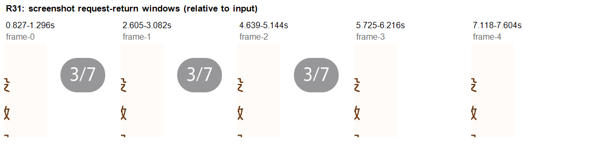

# 魅族 21：小红书 8.72.0 滑动与导航实测

更新：2026-10-13，Asia/Shanghai。本轮主要观察时间为 **13:47–14:17**，承接上午的设备接入与首屏观察。用户选择先测手机现有 8.72.0，再对照新版；本轮没有升级 App。

已完成图集、视频、评论、搜索、作者主页、首页频道及同城地图的浏览交互测试。共记录 **91 个观察/尝试编号：89 个有效观察、1 个无效尝试、1 个记录不完整的尝试**。有效观察含 88 组截图与页面层级，以及 1 组录屏和五次时序采样。它们支撑 30 条交互结论，不等于 91 个完整测试用例，也不代表整个 App 已完成研究。

后续深度研究已补排版量化、R31 逐帧分析及 T02/T03/T05/T06 四段转场录屏，见[深度研究入口](../深度研究/00-深度研究阅读入口.md)。下方 91 个编号仍专指原 R 系列，不与新增 T 系列合并计数。

直接用于后续开发的资料：

- [滑动与导航复刻规格](05-滑动与导航复刻规格.md)：每条行为的前提、动作、结果和实现建议。
- [实测覆盖与待补测](06-实测覆盖与待补测.md)：对应原 100 项清单，明确未覆盖分支。
- [结构化交互证据](交互证据/index.json)：逐条动作、时间、结果、文件摘要与截图。
- [复刻验收场景](交互证据/复刻验收场景.json)：30 个未来独立实现的验收参考，尚未在复刻 App 上执行。
- [证据与交付校验](07-证据与交付校验.md)：交付文件和证据核验结果。

## 设备和版本

| 项目 | 实际读取值 |
|---|---|
| 设备 | MEIZU 21，别名 `meizu21-A` |
| 系统 | Android 16 / API 36 |
| 屏幕 | 1080×2340，440dpi，竖屏 |
| 包名 | `com.xingin.xhs` |
| 运行版本 | `8.72.0 / 8720916` |
| 安装来源记录 | `com.meizu.mstore` |
| 提取 APK | 单个 base.apk，143,291,840 字节 |
| APK SHA-256 | `44b2c6ee8247d4f21ef58974bfe3f4f18318b5918ff01857b18d84827d2f05a5` |

系统记录的安装来源不等于签名验证。三包签名仍待核验。旧报告的 8.84.5.5 静态代码、本轮 8.72.0 真机行为、已取得的 9.49.1 静态包，分别作为独立基线；不能交叉冒充运行结论。

## 对复刻最有用的发现

| 范围 | 本轮可证实的行为 | 证据 |
|---|---|---|
| 图集 | 短拖回原图；较长横滑单页切换；正文不横移；首末图继续滑动不跨帖 | R27–R37、R41–R47 |
| 页码 | 翻页后数字页码显示，静置数秒后渐隐；逐帧拟合与同版静态配置见深度研究 | R29–R31 |
| 视频 | 单击暂停成立；拖进度后继续播放；短拖不切视频，长滑切上下条；回上一条时未从零播放 | R02–R05、R12–R14 |
| 评论 | 视频用底部抽屉，图文在详情内滚到评论；抽屉标题/输入栏固定，可展开回复、下拖关闭 | R06–R11、R19 |
| 评论重开 | 关闭再打开后回顶部，之前展开的回复折叠 | R07–R10 |
| 作者主页 | 资料头收起、栏目吸顶；切回笔记时所选层级节点恢复，但截图差 56px；返回详情保留图片索引 | R48–R54 |
| 搜索 | 结果上滑时分类行收起；详情返回保留关键词和列表，已打开标题变灰；筛选选择后面板未关，结果已更新 | R57–R68 |
| 搜索分类/历史 | 用户分类内换词后仍留在用户分类；历史支持编辑与单条删除 | R69–R78 |
| 首页 | 顶部下拉更新内容；横滑关注再回发现，恢复此前发现卡片 | R80–R82 |
| 同城地图 | 地图平移与面板展开分开；点击探索展开地点列表，下拖收起；页面返回可回同城 | R83–R91 |

图文评论和视频评论的容器区别，可分别查看 [图文评论](截图/R19-image-comments.png) 与 [视频评论抽屉](截图/R06-video-comments.png)。它们不适合用同一个外层滚动布局直接套用。

## 必须保留的差异与未知

1. **返回位置不是全局严格相同。** R01→R15、R26→R54、R59→R61、R50→R52 的所选文字与 XML bounds 对应。像素复核发现 R50→R52 同一图片区域上移 56px；R16→R21 同组卡片约偏移 217px。截图与 XML 并非同时采集，不能确定偏移原因。R59→R61 还存在已打开标题从 #333333 到 #999999 的颜色变化，因此节点一致也不等于画面一致。
2. **搜索两处排序显示不一致。** 点击快捷“最新”后，完整筛选面板仍选中“综合”。该现象已保留，不把两者默认为必定同步的同一状态，也不把不一致直接列为复刻要求。
3. **随机词没有产生真正空态。** 用户分类仍有模糊匹配，全部分类仍有松散相关内容和提问引导，不能交付伪造的“空搜索结果”规则。
4. **同城与地图结果城市不一致。** 同城页与探索结果指向不同城市，具体定位来源、权限、默认视口或服务端原因未确定。一次系统返回也未退出地图，随后可见页面返回按钮成功退出；这两个现象都待复测。
5. **无障碍标签与画面可能不同。** 实际暂停时按钮仍标为“暂停”；作者页、搜索页的页面层级中还留有被遮挡的后方节点。可见状态以截图及后续稳定观察为准。

## 页码时间观察

R31 输入左滑后，五次采样的请求—返回区间如下。真正截图时刻在各区间内；数值相对于电脑发出输入的时间，并非从 App 内部手势结束帧开始计算。

| 采样 | 相对输入时间 | 数字页码 |
|---|---|---|
| frame-0 | 0.827–1.296 秒 | 可见，3/7 |
| frame-1 | 2.605–3.082 秒 | 可见，3/7 |
| frame-2 | 4.639–5.144 秒 | 可见，3/7 |
| frame-3 | 5.725–6.216 秒 | 不可见 |
| frame-4 | 7.118–7.604 秒 | 不可见 |

这五次截图本身只支持“翻页后保留数秒再隐藏”。本轮已进一步分析同一录屏：实际文件长 11.2678 秒，105 帧，采用每帧 PTS；页码淡出拟合约 195ms，与同版 8.72.0 的 200ms 加速淡出静态配置相容。5000ms 是代码中从淡入完成回调安排的延迟，不能当作从电脑输入开始精确测得的等待时间。完整方法、误差与裁切录屏见[深度研究](../深度研究/00-深度研究阅读入口.md)。

## 现场和证据处理

R 系列结束时手机停在发现首页（R91）；后续深度研究结束于 T07，同样返回发现首页。本轮未发布笔记、评论或消息，未点赞、收藏、关注、提交推荐偏好或执行交易。搜索会产生历史；R 系列结束前只删除了本轮添加的两个测试词，保留原有历史。浏览行为可能被 App 自身计入历史或推荐反馈，本轮未尝试清除这类服务端记录。交付文字用“公共测试词 A / 随机测试词 B”代替实际输入。

新增 25 张交付图片只选用公开内容及工具区域：普通截图裁掉顶部系统栏与底部系统导航区，长按菜单仅保留工具行，页码对照图为局部裁切拼接。原搜索历史、联系人、真实关注关系和附近定位截图不放入交付包，原始页面 XML 也不直接分发。

R25 因前台切换而无效，误截的无关 App 图片已删除，其旧摘要不代表可用图片。R38 长按尝试缺少完整采样，只能使用随后 R39 对菜单状态的观察。早期 D021 因系统小窗而无效的尝试已由本轮有效图集测试补充，不追改其历史状态。

设备读取的 REA 证据沿用：设备 `ev_6acef1998bcc6f8bfcefea4d2c91af773dae62ac13e09aeab1ca6a5a5ad87af3`；显示 `ev_350c654df91c1bd7a666faba3e9a9f1185b38d7bd9827107b4218a8ff8f17a15`；版本 `ev_d28b82809fde85212e22d90f3376851e1febf7df49093d18a94177bee8e50083`；APK 提取 `ev_a7993254470eb671fb64cd093c395f2895ec02f2a732c845c49e851b16af095b`。R 编号是本地真机观察编号，不冒充 REA 返回的 Evidence ID。

下一阶段重点为多点触摸与返回取消、动效重复样本和中断、真正空态及网络失败、创作草稿、消息/直播和新版真机对照，详见[补测表](06-实测覆盖与待补测.md)。本轮未开始开发复刻 App。
