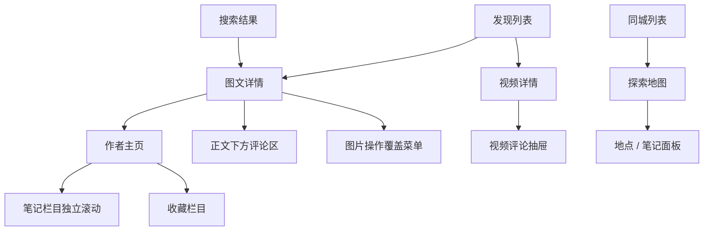

# 滑动与导航复刻规格：8.72.0 真机观察版

2026-10-13。本文件将真机行为转为后续独立实现可用的页面事件规格。每条“观察”只对应魅族 21 上的 8.72.0、本次账号与会话；“实现建议”是自研选择，不是恢复出的源代码、私有协议或服务端算法。原始动作和摘要见[交互证据索引](交互证据/index.json)，总结果见[实测报告](04-魅族21真机实测.md)。

## 1. 页面分层与手势归属

图中表示本轮实际进入的页面或面板，箭头不代表所有可能入口；例如搜索内打开视频没有在本轮执行。

| 触摸区域 | 本轮观察的归属 | 独立实现建议 |
|---|---|---|
| 图文媒体区横向 | 图片分页，正文不横移 | 将横向页码和正文纵向偏移分开保存 |
| 图文正文与评论区纵向 | 同一详情内容流上下滚动 | 作者栏和底部互动栏固定，评论入口定位到评论锚点 |
| 视频媒体区纵向 | 上下条视频分页 | 与播放进度条、右侧互动按钮隔离命中区 |
| 视频底部进度条横向 | 调整时间位置 | 命中进度条后持续归属拖动条，结束时明确播放态 |
| 视频评论列表纵向 | 滚动评论内容 | 标题/输入固定；列表滚动与顶部拖拽关闭分开 |
| 地图主体 | 平移地图 | 面板拖动由面板区域负责；地图平移不等于展开面板 |
| 首页频道横向 | 发现与关注切换 | 每频道维护自身内容和滚动状态 |

没有测试斜向拖动、多点触控、边缘系统返回中途取消，因此不能声称已得出完整手势冲突判定优先级。

## 2. 图文与图集 G01–G05

| ID | 前提与事件 | 实际结果 | 证据 |
|---|---|---|---|
| G01 | 七图笔记第 1 张，短距离横拖松手 | 仍为 1/7 | R27、R28 |
| G02 | 在媒体区域左滑/右滑 | 本次每次切一张；1→2→3→…→7，反向回到 1；正文不横移 | R29、R31–R36、R41–R46 |
| G03 | 末图继续左滑、首图继续右滑 | 仍在边界页；没有跨帖或退出详情 | R36–R37、R46–R47 |
| G04 | 翻页后停止操作 | 数字页码先显示，数秒后隐藏；底部圆点与右上数字是不同元素 | R29–R31 |
| G05 | 长按尝试后观察菜单，再系统返回 | 存在图片工具菜单，关闭后仍为第 7 张 | R39–R40；R38 为不完整尝试 |

独立实现可采用最小状态：`noteId、imageIndex、imageCount、bodyScrollAnchor、indicatorVisible、overlay`。横向翻页只改变图片相关状态，详情滚到评论区只改变纵向位置，菜单打开/关闭保留当前图片。用内容 ID 关联这些状态，不依赖当前屏幕上第几张卡片。

数字页码计时器建议在有效图集交互后更新，但“轻触是否重置”未实测。后续同版静态研究确认默认链为淡入 200ms、完成后延时 5000ms、淡出 200ms；R31 的淡出像素拟合约 195ms。两类证据及限制分列在[深度研究](../深度研究/00-深度研究阅读入口.md)，不能将其当作全 App 通用动效常量。

单图样本点击图片中央没有进入独立大图（R17–R18）；这只否定本次入口尝试，不能推断整个版本没有大图。双击、多点缩放、拖移图片均待测。菜单中的“保存”“搜图中内容”“合拍”“不感兴趣”仅验证入口可见，没有触发业务操作。[工具行截图](截图/R39-image-tools-only.png)。

## 3. 视频 V01–V04

| ID | 前提与事件 | 实际结果 | 证据 |
|---|---|---|---|
| V01 | 打开后自动播放，点击中央并等待 | 出现中心播放三角；两次观察仍为约 12/45 秒 | R02–R04 |
| V02 | 已暂停时拖动底部进度条 | 跳至约 36/45 秒，后续继续播放 | R04–R06 |
| V03 | 在视频主体短拖/长滑 | 80px 短拖不切换；较长上滑到 B，下滑回 A | R12–R14 |
| V04 | 从 B 切回 A | 回到约 44/45 秒，没有从头播放 | R13–R14 |

独立实现建议把 `activeVideoId、playbackState、positionMs、durationMs、seeking、commentOverlay` 分开。暂停按钮文案不能成为播放状态的唯一依据：本样本实际暂停时无障碍描述仍为“暂停”。进度条拖动结束采用什么播放规则需要明确，本次样本表现为恢复播放。

上一条回来的进度只支持“未从零开始”，不能据此判断隐藏视频是否一直播放、提前缓存了几条或什么时候停止音频。视频循环、缓冲、前后台、锁屏、横屏、系统音频焦点都未覆盖。

## 4. 评论 C01–C04

| ID | 事件 | 实际结果 | 证据 |
|---|---|---|---|
| C01 | 点击图文或视频评论入口 | 图文滚到整页评论区；视频打开抽屉并缩小上方视频 | R06、R19 |
| C02 | 点“展开 2 条回复” | 增加两条同级缩进回复，有明确回复对象 | R06–R07 |
| C03 | 滚动评论 / 系统返回 / 下拖面板顶部 | 评论主体滚动，标题和输入固定；返回或顶部下拖可关闭 | R08–R09、R11 |
| C04 | 展开并滚动后关闭，再重开 | 回评论顶部，子回复折叠 | R07–R10 |

建议评论数据统一建模为根评论、回复目标、子回复，但图文详情滚动容器和视频评论面板分别实现。视频抽屉的 `scrollOffset、expandedReplyIds` 可按此次观察在新会话重置；不要因为作者页会保留位置，就让所有面板复用同一种恢复策略。

本轮没有发送评论、点赞评论、切换排序、触达主/子评论分页末尾或验证发送失败。两条回复的展示不能证明任意深度评论都只有一层，也不能推出总评论计数的统计口径。

## 5. 作者主页与页面返回 N01–N04

| ID | 事件 | 实际结果 | 证据 |
|---|---|---|---|
| N01 | 发现→详情→作者，然后逐级返回 | 回原详情且仍是原图片，再回发现 | R48、R53–R54 |
| N02 | 作者主页向上滚动 | 资料头收起，笔记/收藏吸顶，顶部保留操作入口 | R49–R50 |
| N03 | 已滚动笔记→收藏→笔记 | 所选卡片文字和 XML bounds 一致；截图同一图片区域相差 56px，原因未确定 | R50–R52 |
| N04 | 从详情返回首页 | 两组基线恢复；另一组约偏移 217px，不能泛化为完全一致 | R01/R15、R26/R54、R16/R21 |

建议导航项保存 `sourceRoute、queryKey、contentId、scrollAnchor、imageIndex` 等恢复信息；作者页另存 `activeTab、tabAnchors、headerCollapse`。这些字段是独立实现方案，不是原 App 字段名称。

返回验证以稳定基线比较内容身份与相对偏移；加载中或惯性滚动中的截图不适合作为像素恢复标准。若图片补载导致卡片高度变化，自研实现优先维持同一内容的视觉锚点，再评估像素偏差。这是工程建议，不是对 R16 偏移原因的认定。

收藏页看见“笔记 / 专辑 / 合集 / 地点”子分类，仅证明入口文字存在；本轮没有进入合集，因此不能把这个“合集”直接等同旧包里作者系列的 `Collection/Portfolio` 对象。

## 6. 搜索 S01–S09

| ID | 事件 | 实际结果 | 证据 |
|---|---|---|---|
| S01 | 搜索起始页输入公共测试词 A | 展示联想；防抖时长未知 | R24、R55–R56 |
| S02 | 搜索结果向上滚动 | 分类行收起，搜索框和条件行留在顶部 | R57–R59 |
| S03 | 从中部结果打开图文再返回 | 关键词、卡片和所选边界恢复；已打开左卡标题 #333333→#999999，右卡不变 | R59–R61 |
| S04 | 点快捷“最新”，打开筛选 | 结果更新回首；完整面板仍显示“综合”选中 | R62–R63 |
| S05 | 面板中选图文，收起后重开 | 选择时背后结果已变化；面板保持打开；重开保留图文 | R63–R66 |
| S06 | 重置后系统返回 | 类型回不限、面板仍打开；返回只关面板 | R66–R68 |
| S07 | 用户分类内清空并提交新词 | 仍在用户分类 | R69–R72 |
| S08 | 查随机词，再切全部 | 仍有模糊/松散结果和提问引导，未得到真正空态 | R71–R73 |
| S09 | 历史编辑、逐条删除、完成 | 移除本轮两个测试词，原历史保留 | R74–R78 |

完整筛选面板可见的条件如下；**只有图文、重置、收起及重开路径被实际操作**，其余仅验证文案存在。

| 条件组 | 可见选项 |
|---|---|
| 排序 | 综合、最新、最多点赞、最多评论、最多收藏 |
| 笔记类型 | 不限、视频、图文、直播 |
| 发布时间 | 不限、一天内、一周内、半年内 |
| 搜索范围 | 不限、已看过、未看过、已关注 |
| 位置距离 | 不限、同城、附近 |
| 面板底部 | 重置、收起 |

建议至少区分 `draftQuery、submittedQuery、resultCategory、filters、panelOpen、resultAnchor、readNoteIds`。阅读状态作为卡片颜色输入；重启后是否保留仍未测。类型筛选即时生效可按实测采用；其他条件是否即时生效、是否互斥需补测。为避免旧请求覆盖新词，可采用请求序号或取消机制，这是自研建议，未测得原 App 内部实现。

快捷最新与完整排序的不一致不应悄悄被“修正”为已证实同步。独立产品可以选择统一状态来源，但要在实现记录中明确这是主动设计。也不能把本次重置“图文→不限”扩展成所有筛选和快捷排序都同步清空。

真空态、网络错误、结果分页终点都没有样本。建议独立实现分别准备“无精确匹配但有推荐”“没有内容”“网络失败”三种状态，后两种是必要的自研验收补充，不是原 App 已观察画面。

## 7. 首页频道与地图 F01–F02、M01–M02

| ID | 事件 | 实际结果 | 证据 |
|---|---|---|---|
| F01 | 发现页顶部下拉 | 首批卡片改变，二级频道可见 | R79–R80 |
| F02 | 向右切关注，向左回发现 | 回原发现卡片及位置 | R80–R82 |
| M01 | 同城探索→拖地图→点探索→下拖面板 | 地图平移时面板保持收起；点击后展开地点列表；下拖收起 | R85–R88 |
| M02 | 再点当前城市、尝试返回地图 | 再点城市刷新列表；一次系统返回未退出；页面返回成功 | R83–R84、R89–R91 |

发现页重新看到推荐、直播、短剧、美食、穿搭、旅行等二级频道，不代表这些是刷新新增功能；此前视图可能处在不同滚动位置。当前城市文字被点击后没有出现城市选择器，因此不能把该点击定义成城市选择事件。

地图最小观察状态可表示为 `地图+收起面板 → 探索 → 展开地点列表 → 下拖 → 地图+收起面板`。地点和笔记是面板的两个可见标签，本轮只查看地点结果。地图未测试双指缩放、位置权限、拖图是否自动刷新结果和城市切换。城市不一致及系统返回未退出均保留待复测，不复制为正常业务逻辑。

## 8. 可重复输入样本与计时边界

坐标基于原始 1080×2340 屏幕，原点在左上角，格式为起点→终点。交付截图裁掉了顶部 92px，不能直接拿截图坐标控制原设备。下表时间是输入手势持续时间，不是动画耗时。

| 场景 | 实测输入 | 输入持续 | 结果 |
|---|---|---|---|
| 图集短拖 | (680,930)→(590,930)，90px | 700ms | 保持 1/7 |
| 图集较慢左滑 | (870,930)→(200,930)，670px | 600ms | 1/7→2/7 |
| 图集较快左滑 | 相同 670px | 200ms | 2/7→3/7 |
| 图集逐页 | 相同 670px，反向为 (200,930)→(870,930) | 250ms | 每次一张 |
| 图集边界 | 相同 670px | 400ms | 保持首/末页 |
| 视频短拖 | (508,1310)→(508,1230)，80px | 650ms | 不换视频 |
| 视频下一条 | (505,1710)→(505,650)，1060px | 420ms | 切 B |
| 视频上一条 | (505,650)→(505,1720)，1070px | 420ms | 回 A |
| 视频进度条 | (286,2140)→(780,2140) | 800ms | 到约 36/45 秒 |
| 评论下拖关闭 | (516,743)→(516,1650) | 600ms | 关闭抽屉 |
| 作者页上滑 | (691,1920)→(691,490) | 600ms | 资料头收起、栏目吸顶 |
| 发现下拉刷新 | (532,490)→(532,1520) | 700ms | 首批卡片变化 |
| 发现→关注 | (212,980)→(886,980) | 550ms | 切到关注 |
| 关注→发现 | (866,980)→(210,980) | 550ms | 恢复发现 |
| 地图平移 | (673,1200)→(420,920) | 500ms | 地图移动，面板不展开 |
| 地图面板收起 | (536,183)→(536,1710) | 600ms | 收起面板 |

图集 90px 约占屏宽 8.3%，670px 约占 62.0%。这两个输入的速度也不同，不能从“一个不翻页、一个翻页”算出真实距离阈值。后续标定应固定速度逐步改变距离，再固定距离改变速度，并加斜向、取消和多点触摸；不要把这组样本硬编码到不同尺寸设备。

R31 的五次页码采样详见[实测报告](04-魅族21真机实测.md)，后续逐帧结果与四段新增转场详见[深度研究](../深度研究/00-深度研究阅读入口.md)。采样耗时包括设备与电脑传输，普通动作后也有等待再截图的过程；均不能当成 App 响应时间。逐帧结果也不等同于全 App 帧率或性能结论。

## 9. 独立实现如何验收

随附[结构化验收场景](交互证据/复刻验收场景.json)提供上述 30 条事件的 Given/When、实际参考结果与实现选择。它们当前全部标记为“未在复刻工程执行”。开发时每条应补实现位置、采用/改动理由、实测录像和通过/失败结果。

先用自制七图笔记、两段自有短视频、带两条回复的测试评论、可稳定分页的搜索结果建立固定数据。卡片和用户用内部 ID 关联，保持媒体、评论、路由的状态边界。随后再验证不同屏幕、网络错误和生命周期，不以真实推荐内容每次不同作为复刻失败。

本轮可以直接指导核心浏览交互的开发，但发布草稿、社交提交、消息、直播、权限异常仍需独立研究；详见[覆盖表与下一轮顺序](06-实测覆盖与待补测.md)。
