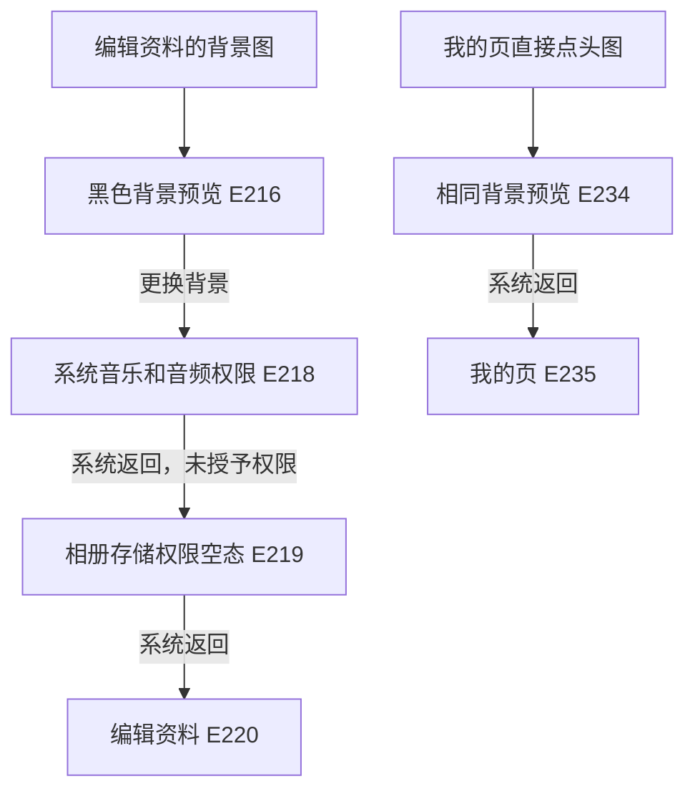

# 背景图入口、权限和静态裁剪

## 两个现场入口

| 入口 | 证据 | 结果 |
|---|---|---|
| 我的页→编辑资料→背景图行 | E215/E216 | 打开`com.xingin.matrix.profile.ProfileBannerImagePreviewActivity` |
| 我的页直接点头图`(800,250)` | E233/E234 | 打开同一个旧版Activity，系统返回回我的页（E235） |

E216/E234完整XML相同，去顶部42px后画面逐像素相同。`ProfileBannerImagePreviewActivityV2`只作静态候选；编辑资料现场是`XhsReactActivity`，不能用候选类名替代。

预览背景取样`#000000`；图片节点`[0,528,1080,1392]`，当前1080×864px。关闭点击区`[11,77,88,154]`；底条容器`[56,1614,1024,1699]`，更换背景点击区`[56,1615,1024,1699]`，右侧图标`[954,1636,996,1678]`。底条纯色取样`#222222`。5:4只是当前预览节点比例，不证明所有图片处理规则。

## 更换、权限与取消路径

点击更换背景后，E217旧采集器因前台不再是小红书而中止，只留下录像和失败记录；E218单独捕获Android的`GrantPermissionsActivity`。提示请求音乐和音频，不能改写成照片权限，也不能由此断定该包只需要音频权限。

研究只用系统返回关闭提示，未点击允许或不允许。E219随后为`XhsAlbumActivity`，显示未开启存储权限的空态和“去开启权限”。没有进一步授权或选择图片。系统返回可能影响拒绝计数，故不声称系统权限历史完全未变。

E220直接回编辑资料，跳过背景预览。这个观察不能反推所有来源都有同样的返回栈。

## 同版APK静态补充

APK SHA-256：`44b2c6ee8247d4f21ef58974bfe3f4f18318b5918ff01857b18d84827d2f05a5`。PB编号到实际`evidence_id`、目标摘要、原件摘要和方法状态的映射见[静态数据](static-findings.json)。

| 证据 | 确认的片段 | 保留的限制 |
|---|---|---|
| PB022 | 旧Activity创建背景Fragment，调用`disableSwipeBack`和`overridePendingTransition` | 不提供具体动画时长或侧滑实测 |
| PB010/PB025/PB038 | 首控件经`EditInfoBean`非空且`a()`为真的条件后进入`g7`；保留`edit_profile_list`来源，否则传`profile_page`；随后在状态未保存时弹栈并关闭背景页 | 业务门槛不是已证明的Android权限校验；只与现场返回跳过预览相容 |
| PB011/PB023 | selector表达式为1，选择`Rectangle(500,400,-65536)`分支 | 500×400不是已确认输出像素或实际裁剪框大小 |
| PB039/PB041 | `Image.d(1)`写入`maxCount=1` | 数量上限配置为1，不等于本次实际选过图 |
| PB040/PB042 | 三个矩形参数只见写入混淆字段 | 实际宽高/比例语义未确认 |
| PB008/PB027 | 裁剪Activity读取source/function/shape/callbackKey、源图路径/URI和选择配置，有背景/头像及来源分支 | 仅为参数槽位，不是本次实际Intent值 |
| PB028 | `n7`调`m7`，带`CommentStickerInfo.BANNER`与`banner_image` | 中间封装未完全展开 |
| PB030/PB033/PB043 | 独立恢复的`l7`调`com.xingin.matrix.ProfileUploader`；结果壳有success/code/message/data及错误回调 | 不是闭合的选图到保存链，服务器字段与保存成功未验证 |

PB018/PB019的`W6/Y6`是贴纸装扮路由；PB029背景点赞/取消喜欢是另一条服务链。均不并入更换背景上传链，现场也未执行。

43次静态请求中41份是正式Evidence，PB034/PB035是类名错误记录。PB031（Q6）、PB032（M6）、PB037（O6）方法体不可用；即使`sourceStatus=complete`也不能算恢复了方法体。未被此入口选中的形状分支不作为背景参数。

## 下次需要补的具体数据

| 待测项 | 所需条件 | 当前状态 |
|---|---|---|
| 相册网格、选中反馈、来源切换 | 用户自行处理媒体授权，使用非私人测试素材 | 未测 |
| 初始缩放、拖动边界、裁剪比例、取消 | 同一张带尺寸标记的测试图，能进入裁剪页 | 未测，静态字面量不能替代 |
| 压缩、上传进度、失败、返回刷新 | 用户授权实际更改背景，并明确恢复办法 | 未执行账号写入 |
| 真机/新版、不同屏幕与主题 | 对应设备和版本 | 未测，不泛化本轮坐标 |

11段276帧录像仅完成解码、时间戳顺序和原件摘要核验，没有精确动效拟合。未授予媒体权限不影响当前已完成的页面布局、取消返回与静态数据入库。
