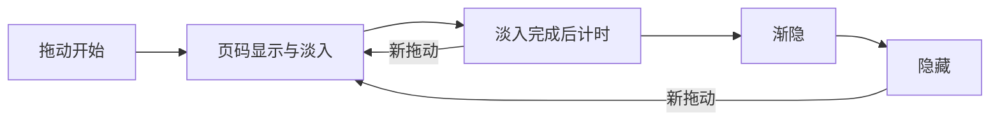

# 复刻参数与验收：研究结果转为实现输入

这是后续独立实现的参考规范，尚未开发或验收复刻 App。使用自己的名称、媒体和数据；当前行为基线固定为魅族 21 的小红书 8.72.0。所有尺寸先在 1080×2340、440 dpi、字体缩放 1.0 下对照，再扩展到其他设备。

## 参数分四类使用

| 类别 | 含义 | 如何使用 |
|---|---|---|
| 实测几何/像素 | 截图与 XML 的样本读数 | 原 px 是回归基线；dp 由 2.75 px/dp 换算，不冒充源码常量 |
| 逐帧观察/拟合 | 从录像 PTS 和像素位置推导 | 保留样本、区间和误差；不能把近似值写成全 App 常量 |
| 同版静态配置 | 8.72.0 打包默认方法分支 | 可作为实现候选，保留实验配置和热补丁的影响 |
| 实现建议 | 根据证据制定的自研选择 | 单独记录采用理由，不声称恢复了原代码 |

机器可读版本见 [复刻参数.json](复刻参数.json)。完整排版 84 项及光栅读数见[排版测量](排版/layout-findings.md)，所有动效样本见[逐帧报告](动效/motion-findings.md)。

## 排版候选

| 区域 | 样本值 | 实现时的边界 |
|---|---|---|
| 首页双列 | 两列各 521px；外边距 13px；中缝 12px | 自适应两列，不以整行最高卡片强行等高 |
| 顶栏/标签栏 | 121px = 44dp | 系统安全区另算，不能固定状态栏为 92px |
| 详情作者栏/互动栏 | 154px = 56dp | 固定栏与正文滚动层分离 |
| 正文左右 | 41px ≈ 14.91dp | 可先采用约 15dp 候选，再以文字排版回归 |
| 图集媒体 | 当前样本 1080×1336px | 高度由内容与约束决定，不能全部写死为 1336px |
| 图集数字页码 | 84×66px；距媒体上/右各 28px | “2/7”宽度会变，按内容测量 |
| 评论回复 | 一级正文 x=157，回复 x=226 | 相对缩进约 25dp，头像与正文层级独立 |
| 视频评论面板 | 顶 y=633、底 y=2271 | 当前占可用高度约 75.2%，未证明跨设备固定比例 |
| 搜索框胶囊 | 高 88px = 32dp | 控件高度与文本字号分开 |
| 筛选选项 | 231×99px = 84×36dp，间隔 22px = 8dp | 四列等宽，末行左对齐；操作栏 48dp |

截图主要色值：列表间隙 #FAFAFA、卡底 #FFFFFF、主强调 #FF2442、标题 #333333、看过的搜索标题 #999999、浅输入底 #F4F4F5、筛选选中底 #FFEDF0。它们是已合成像素，不是完整设计令牌。字号、字重、字体族、图标路径和多数圆角资源值尚未恢复；不得由文本框高度直接推 sp。

## 动效与状态

详情进场可先采用约 200ms 的整页右侧滑入候选，返回采用约 300ms 的向右退出候选。它们来自单个入口的像素时序，不是整个 App 的统一规则；不要因图片有 `transitionName` 就直接实现卡片放大式共享元素转场。

图集页码的同版默认代码链为拖动时淡入 200ms → 淡入完成后等 5000ms → 淡出 200ms，淡入淡出使用 `AccelerateInterpolator`。R31 淡出像素拟合约 195ms，与该分支相容。实现时每次新交互取消旧计时，页面销毁时清理任务；完整轻触/重复拖动重置行为仍待实测。

图仅表示已恢复的默认事件关系与自研计时管理候选，不表示已完成所有运行时分支追踪。

图集 `imageIndex`、详情纵向锚点、正文/评论滚动、搜索已读状态、作者页栏目锚点应分别保存。图集横移不带动正文；视频评论关闭重开会重置回复展开与列表顶部，而作者栏目可接续原列表。不能为所有页面套同一种恢复策略。

## 实现验收矩阵

以下均为**未来自研验收，尚未执行**。允许误差是建议值，需要结合字体、屏幕和系统版本单独定标，不属于原 App 的保证。

| ID | 固定数据与动作 | 必须检查 |
|---|---|---|
| DR01 | 同尺寸屏幕，双列自制长短标题卡片 | 两列宽度、外边距、中缝、独立列高度与固定导航 |
| DR02 | 自制七图笔记，横翻前两张 | 正文位置不横移，媒体框在当前样本内稳定，页码正确 |
| DR03 | 7 张以上图集连续翻页 | 点状指示器不盲目与总图数等量；窗口算法未定前标为自研选择 |
| DR04 | 进入详情后返回首页 | 整页平移方向正确；约 200/300ms 分别对照，内容加载不混算转场 |
| DR05 | 页码从显示到消失 | 验证透明度渐隐；区分淡入完成、等待、淡出三个阶段 |
| DR06 | 页码等待中再次拖动，随后退出 | 没有旧任务提早隐藏或页面销毁后继续触发 |
| DR07 | 打开视频评论并关闭 | 跟踪白色面板边缘，保持标题/输入固定；视频变化不计为面板位移 |
| DR08 | 一级评论、两条回复、内嵌图片 | 回复缩进、可见滚动终点、底部输入覆盖关系正确 |
| DR09 | 搜索中部打开一张卡，再返回 | 关键词/筛选/锚点恢复，打开卡标题变灰，未打开卡不变 |
| DR10 | 搜索上滑、展开完整筛选 | 分类栏与条件行按状态显隐，不把 XML 隐藏节点叠到画面上 |
| DR11 | 作者页折叠、切栏目再返回 | 用停稳前后帧比较锚点；不得用 R50/R52 当零偏移基线 |
| DR12 | 媒体加载较慢、列表快速复用 | 正确占位、尺寸与稳定 key，旧请求不覆盖新卡片 |
| DR13 | 更新同一笔记状态后回列表 | 先渲染当前快照，再接续变化；视图重绑定不误播互动动画 |
| DR14 | 60/120Hz 与不同动画倍率 | 几何终点一致；用 PTS/完整帧时间线测时，不用总帧数除以固定 FPS |
| DR15 | 大字体与另一密度 | 安全区、文字换行、输入栏与面板可见范围；当前只有单机基线 |
| DR16 | 更高版本相同页面 | 先记录真实行为再采用差异；9.49.1 静态分支不代替真机验证 |

网络失败、空态、长列表末页、发布草稿、私信/群聊和非交易直播继续沿用[原覆盖清单](../新版研究/06-实测覆盖与待补测.md)。已有只读样本不代表这些场景已研究完成。
