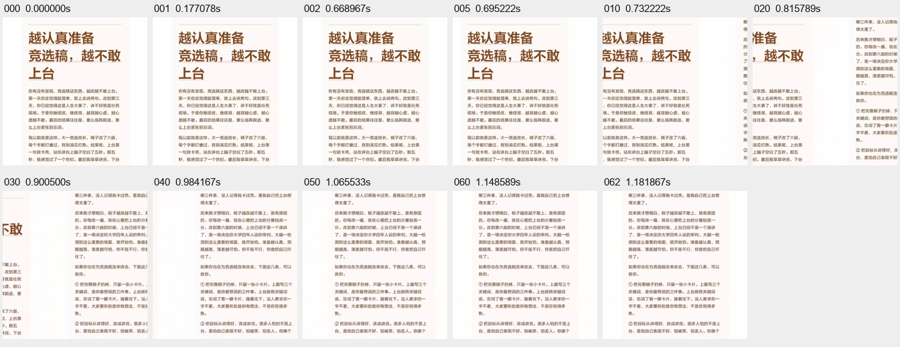
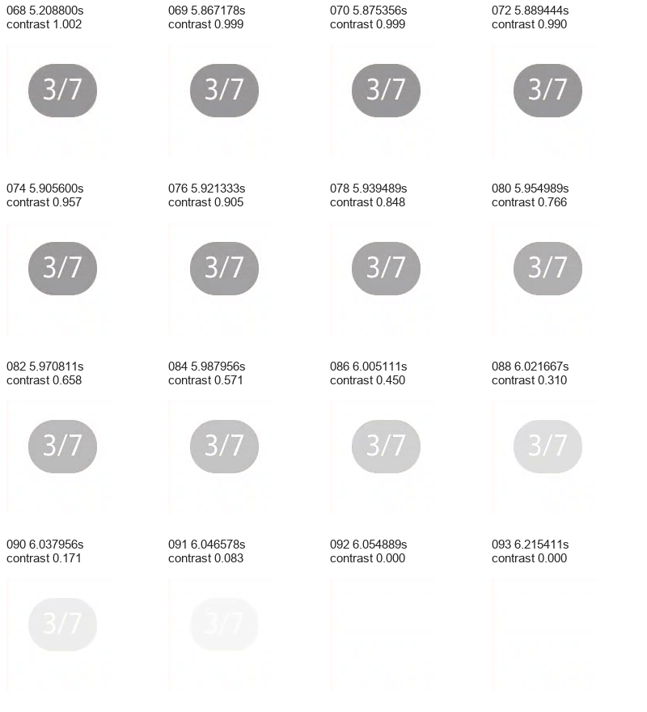
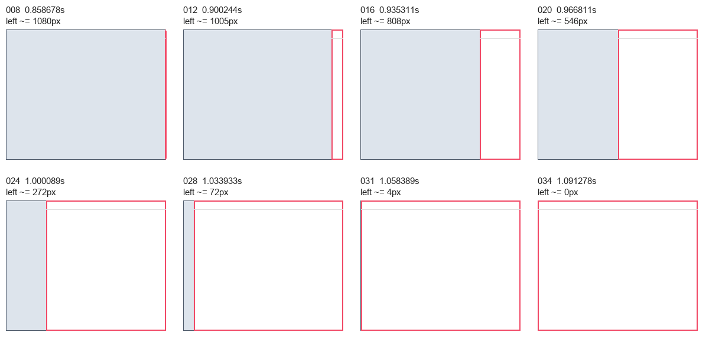
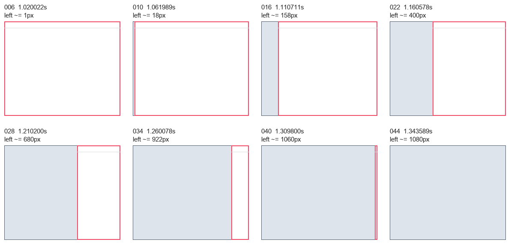
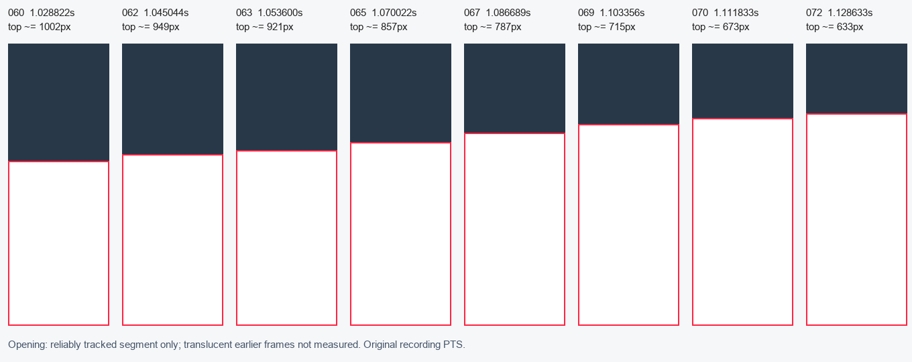
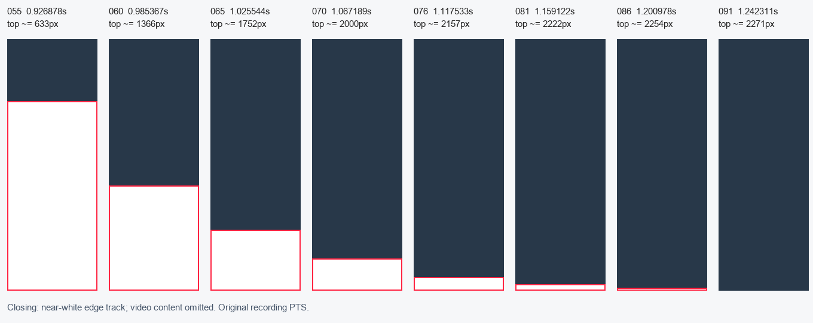

# 动效逐帧研究

本报告把魅族 21、Android 16、小红书 8.72.0 的五段录屏分开分析：复用的 R31 图集翻页与页码淡出，以及本轮新增的 T02 详情进入、T03 详情退出、T05 评论面板展开和 T06 评论面板收起。时间均来自原始录屏的 PTS（timebase `1/90000`），不把电脑发出输入的时刻当成 App 内部动画起点。

## 结论摘要

| 观察 | 逐帧结果 | 复刻时可采用的候选 | 证据边界 |
|---|---:|---:|---|
| R31 图集媒体横移 | 首次可见变化 0.678556s；3px 网格匹配在 1.148589s 到达 1080px；约 1.156733–1.181867s 后稳定 | 媒体区横向分页，正文区保持独立；吸附时长不要写死为单一 FPS 帧数 | 手势结束没有和录屏 PTS 同步，不能把整段写成脱手吸附时长 |
| R31 数字页码淡出 | 二次曲线解释拟合起点 5.860s、时长 0.195s、RMSE 0.007044 | 可先用 200ms 渐隐；同版静态配置还显示淡入 200ms、完成后等待 5000ms | 拟合来自编码后像素对比度，不是源码 alpha 或插值器恢复 |
| T02 详情进入 | 稳定画面 0.858678s；首变 0.875278s；到左边缘 x=0 为 1.067156s；首变到目标 191.878ms | 整页从右向左约 200ms | 采样上下界约 183.111–208.478ms；内容加载和转场分开观察 |
| T03 详情退出 | 稳定画面 1.035878s；首变 1.044056s；几何到右边缘离屏 1.326544s；尾部残余至 1.343589s | 向右退出约 300ms | 几何段约 282.488ms，含编码/尾部残余约 299.533ms；不把 300ms 当精确源码常量 |
| T05 评论展开 | 面板半透明早期无法用白边稳定跟踪；可靠跟踪从 1.028822s、top=1002px 到 1.120311s、top=633px，共 91.489ms | 采用底部面板向上展开，并与视频缩放分层实现 | 完整展开时长未知；`null` 表示未可靠跟踪，不表示面板不存在 |
| T06 评论收起 | top=633px 保持到 0.926878s；首明显移动 0.942989s、top=791px；末可见 1.225589s、top=2264px；1.234322s 为白边未检出的哨兵 | 向下收起约 0.3s，前快后慢的候选曲线 | 可见几何段 291.333ms，采样上下界约 282.600–307.444ms；插值器类别未知 |

## R31：图集翻页和数字页码

原始录屏共有 105 帧、文件时长 11.2678s，帧间隔是可变的：最小约 3.9ms、中位约 8.389ms、最大约 1.443289s。不能把中位间隔倒数称为 App 持续 119fps，也不能用“总帧数除以 60/120”反推动画时长。媒体区域在 0.678556s 首次出现可见位移；以 3px 网格拼接的起始/目标图像作匹配，位移在 1.148589s 达到 1080px，之后仍有少量编码和内容变化，约 1.156733–1.181867s 稳定。这个结果只描述画面时间线，不证明触摸抬起发生在某个 PTS。

翻页期间的正文区域相邻帧平均绝对差，在 0–255 通道尺度上最小 0.008536、最大 0.330133、均值约 0.033380，支持正文没有随图片明显横移，但不是逐像素完全不变。完整读数见[原录像测量](R31/measurements.json)和[像素跟踪](R31/pixel-measurements.json)。

右上数字页码在翻页后出现，并在静置后消失。对页码局部区域做相对对比度测量，二次解释拟合优于线性和三次拟合：起点 5.860s、时长 0.195s、RMSE 0.007044。8.72.0 静态方法证据显示的候选事件链是“拖动时淡入 200ms → 淡入完成后等待 5000ms → 淡出 200ms”，两类证据相互相容，但都不能证明每个入口、每次重复拖动和中断场景都使用相同参数。实现时应在新交互时取消旧等待任务，在页面销毁时清理任务。

拟合使用 PTS 5.875356–6.054889s 的 23 个样本，模型为 `C(t)=1-clamp((t-t0)/T,0,1)^p`。指数为 1、2、3 的最佳 RMSE 分别约 0.042014、0.007044、0.027400；这里只比较了三类解释模型，不能据此唯一确定原代码插值器。完整模型参数见[曲线拟合](R31/fadeout-curve-fit.json)，同版默认代码见[内部机制报告](../机制/core-findings.md)。

R31 数值依据原录像；交付中的[裁切预览](R31/motion-app-only.mp4)去掉系统栏、无音频，分辨率 1080×2178，原屏幕裁切范围为 `[0,92,1080,2270)`。预览与原片都是 105 帧、11.2678s，逐帧 PTS 最大差为 0，但预览像素经过重新编码。预览校验见[R31/preview-validation.json](R31/preview-validation.json)。

## T02/T03：详情页整页平移

T02 的模型是新详情页从右侧覆盖静止首页，未观察到卡片放大或共享元素缩放。首个稳定前帧约 0.858678s，0.875278s 已出现右侧边缘，1.058389s 仍剩约 4px，1.067156s 到达 x=0。按首变到目标计算为 191.878ms；由于录屏帧采样，适合把 200ms 作为自研候选并在目标设备重新标定。

T03 是相反方向的整页退出，首页从左侧露出。稳定前帧约 1.035878s，1.044056s 首次移动，1.317978s 已露出到 x=1072，1.326544s 到达 x=1080。该几何段约 282.488ms；到 1.343589s 仍可看到很小的尾部变化，因此报告同时记录“含尾部残余约 300ms”。详情进入与退出应分别验收，不能直接套用同一个时长或同一个插值器。

两段均通过中性几何图表达位置变化，图中灰白矩形不是原 App 素材。完整位置和误差保存在[T02/geometry.json](T02/geometry.json)与[T03/geometry.json](T03/geometry.json)，原始帧时间和区域差分保存在各自的 `measurements.json`。T02 的相似白色顶栏在中间几帧会使纯顶栏匹配出现约 964px 的假停滞；应同时看内容变化边缘 `contentChangeBoundaryPx`，不能把这个匹配歧义当成动画卡顿。采样上下界只反映相邻观测帧的时间空隙，不是统计置信区间，也不包含全部像素模型误差。

## T05/T06：视频评论面板

T05 的面板初期为半透明，白色顶边检测会失效。改用面板关闭按钮 X 的图标模板做归一化相关跟踪，相关系数阈值为 0.70，并减去 41px 的标题偏移。可靠结果从 1.028822s 的 top=1002px 开始，1.120311s 到 top=633px，持续 91.489ms；此前的 `null` 只是跟踪不可用。末态可见视频缩小、面板不透明，但视频缩放和面板位移没有被拆成同一条精确时序，所以完整展开时长保留未知。

T06 关闭时使用 x=60..1020 范围内连续三行近白像素检测顶边。面板在 top=633px 保持到 0.926878s，0.942989s 首次明显移动至 791px，随后前段位移较快、接近底部时变慢；1.225589s 仍能看到 top=2264px，1.234322s 进入未检出哨兵 2271px。按可见几何段计算约 291.333ms。该结果支持先用约 300ms 候选，不支持声称使用了某个 Android 标准插值器。

两段跟踪的横向输入缩小为 270px，纵向仍为原始 2340px；近白阈值为灰度 245、横向比例至少 92%。`panelTopPx=2271` 仅是未检测到白边的哨兵，尤其不能拿它替代 T05 早期真实位置。展开结果使用 `trackedPanelTopPx`。T06 初始 633/640px 的小幅阈值抖动不计作动作起点。完整读数见[T05/geometry.json](T05/geometry.json)和[T06/geometry.json](T06/geometry.json)。

## 使用限制

- 五段录屏都来自单台魅族 21、单一系统动画倍率和单一 8.72.0 版本；不能代表 9.49.1、其他 Android 设备或 iOS。
- 录像是可变帧率的屏幕采集；PTS 可用于这五段样本的相对时间，但不能替代原生 `Choreographer` 或动画回调时间。
- 局部像素跟踪会受到编码噪声、视频内容变化、遮罩透明度和采样边界影响；中性几何图只表达测量模型。
- 当前没有做动画重复、快速反向、触摸取消、手势中断、不同动画倍率、多点手势或弱网场景；这些保留在复刻验收表中。

结构化汇总见[metrics-summary.json](metrics-summary.json)，复刻使用顺序与未来验收见[复刻参数与验收](../01-复刻参数与验收.md)，帧快照的性能覆盖限制见[渲染管线与帧采样](../运行/渲染管线与帧采样.md)。

