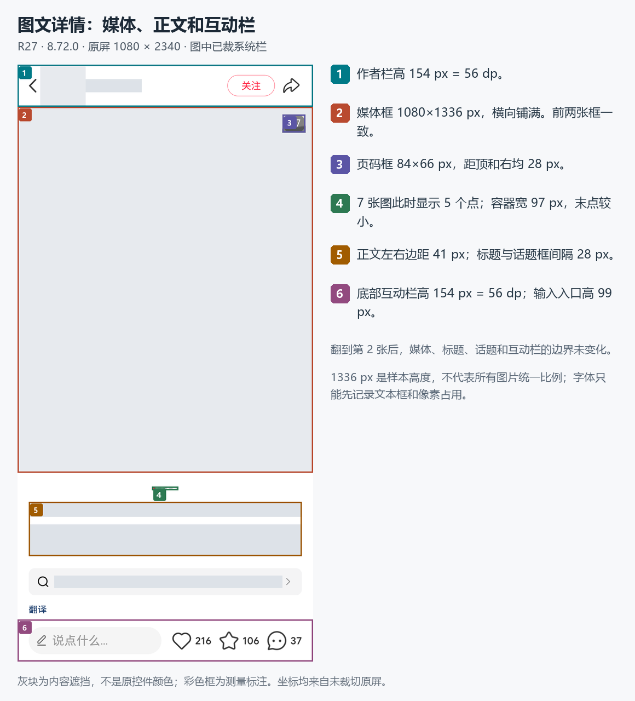
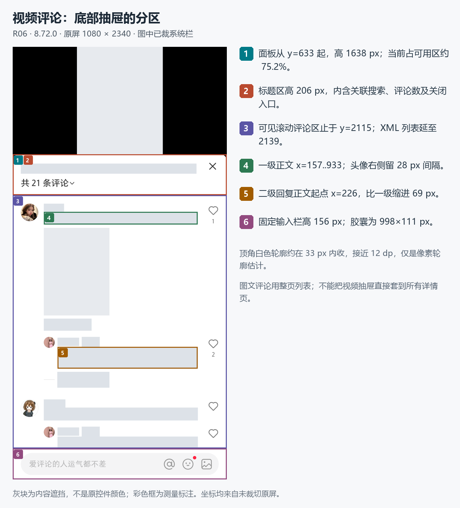
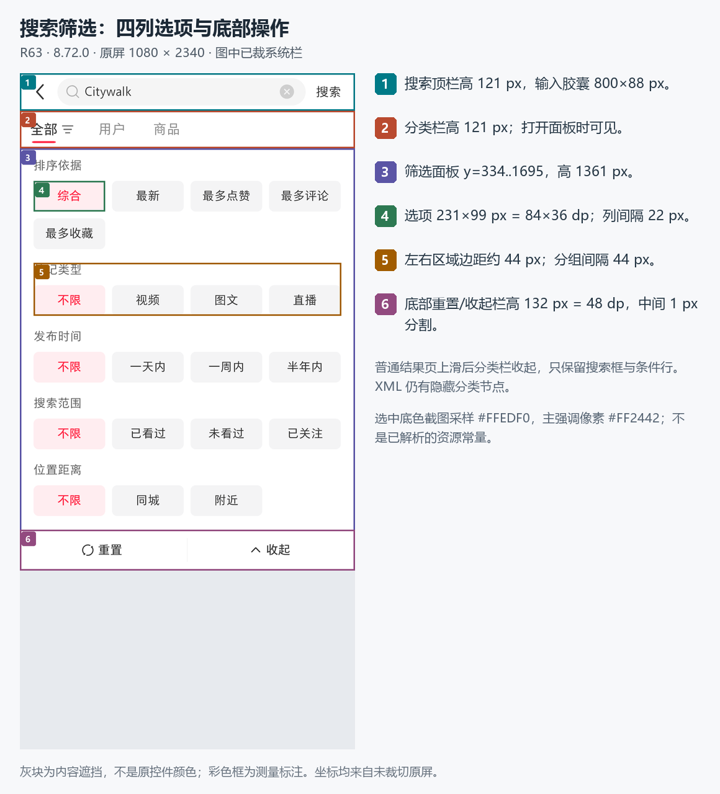
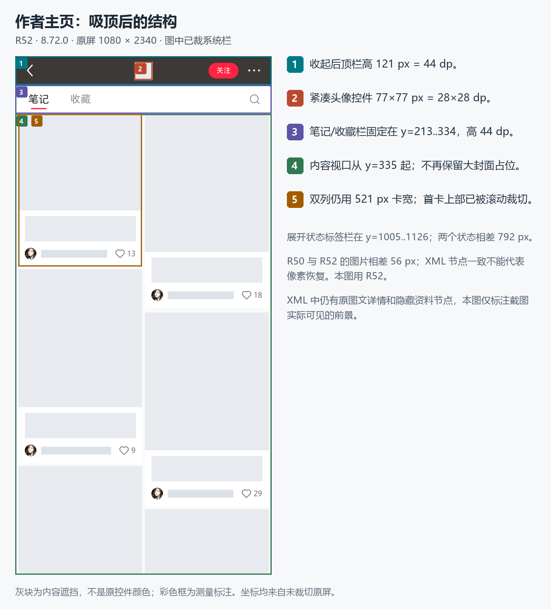

# 小红书 8.72.0 手机排版量化

本轮将既有公开内容样本拆成 **84 项几何记录、12 组颜色采样、4 段文字光栅记录和 6 张标注图**。可以据此搭建布局基线，但不能把单机截图当成所有设备的通用尺寸，也不能由控件矩形直接推定字体参数。

正文统一以公共样本 A/B 代称内容，不抄录作者、帖子身份或评论原文。图中灰块是为突出排版而加的内容遮挡，并非原 App 的占位或颜色。标注图均先从原图裁去系统状态栏 `y<92` 和系统导航栏 `y≥2271`。

## 基线与读数方法

| 项目 | 当前证据与限制 |
|---|---|
| App | 真机 8.72.0 / 8720916；本报告不混用 9.49.1 静态资源 |
| 原始截图 | 1080 × 2340 px；全屏左上角为 `(0,0)` |
| 密度 | `T00-environment` 本轮重新读取 440 dpi，即 2.75 px/dp |
| 字体缩放 | `T00-environment` 重新读取 1.0；并非取得 R 系列截图时同时采样 |
| 系统栏裁切 | 输出参考图使用 `[0,92,1080,2271]`，原坐标不因裁图而重编号 |
| 控件边界 | 来源为指定 R 证据的 UI XML；右、下边界按排他边界做差 |
| 可见边界 | 与原 PNG 核对，排除隐藏前页、被吸顶栏盖住的卡片、被输入栏盖住的列表 |
| dp 换算 | `px / 2.75`，仅辅助复刻；不是已还原的源码常量 |
| 文字 | XML 不提供 `textSize`、字体族、基线或字重，本报告不将文字框高冒充 sp |
| 颜色 | 从未缩放 PNG 的指定区域统计 RGB；只证明截图最终合成像素 |

完整原坐标、XML 节点索引、方法、SHA-256 和局限在 [metrics.json](metrics.json)，便于人工查阅的 84 项表格在 [measurements.md](measurements.md)。R 系列 XML 原始内容留在工作目录，不作为公开导出内容的一部分。

## 发现页：双列瀑布流

证据：`R01`，指标 `F01–F17`。截图与 XML 在列边、标题框和固定导航处吻合。

| 对象 | 当前样本测量 | 对复刻的含义 |
|---|---|---|
| 应用顶栏 | `y=92..213`，高 121 px = 44 dp | 状态栏与应用导航分开处理 |
| 滚动内容视口 | `y=213..2147`，高 1934 px | 顶、底栏从列表空间中扣除 |
| 双列位置 | 左列 `x=13..534`；右列 `x=546..1067` | 两列各宽 521 px，外边距 13 px，中缝 12 px |
| 首卡封面 | 521 × 694 px，约 3:4 | 当前样本比例，不是全部封面的强制比例 |
| 首卡完整高度 | 930 px；第二组左右卡片结束位置不同 | 使用独立列排布，不把整行强制拉成等高 |
| 封面到标题框 | 24 px ≈ 8.73 dp | 媒体与文字之间有独立留白 |
| 标题框 | `x=41..507`，双行高 105 px | 文字相对卡片左内缩 28 px；不是全宽贴边 |
| 作者与互动行 | 510 × 107 px | 左侧头像/名称，右侧点赞数；与标题分区 |
| 卡片纵向间隔 | 当前左列为 13 px | 保留独立的卡片间距 |
| 底部导航 | `y=2147..2271`，高 124 px；5 项各宽 216 px | 固定导航入口等分屏宽 |

当前首卡头像控件为 72 × 72 px，点赞图标控件为 83 × 83 px。这是控件矩形，包含留白，不能直接拿来当头像圆直径或心形图案尺寸。

## 图集详情：满宽媒体与窄正文

证据：`R27、R29`，指标 `G01–G18`。

| 对象 | 当前样本测量 | 证据解读 |
|---|---|---|
| 顶部作者栏 | `[0,92,1080,246]`，高 154 px = 56 dp | 图片从作者栏下方开始 |
| 媒体显示框 | `[0,246,1080,1582]`，1080 × 1336 px | 横向铺满，高度随该样本确定 |
| 数字页码 | `[968,274,1052,340]`，84 × 66 px | 距媒体顶部、屏幕右边各 28 px |
| 点状指示器 | `[491,1632,588,1646]`，97 × 14 px | 7 张图时当前只画 5 个点，末点更小，不能按总图数等量画点 |
| 大点与小点框 | 13 × 13 px / 7 × 7 px | 点的缩小代表分页指示器有窗口化表现；完整移动规则仍需序列证据 |
| 媒体底到点容器顶 | 50 px | 点容器在媒体外的白色区 |
| 正文左右边距 | 41 px ≈ 14.91 dp | 标题、话题与相关搜索共享约 15 dp 边距 |
| 标题框 | 998 × 54 px | 当前为一行；不能将 54 px 当字号 |
| 话题框 | 998 × 116 px | 当前两行；可点击话题表现为蓝色文字 |
| 标题与话题框间隔 | 28 px ≈ 10.18 dp | 两块文字有明确分组间距 |
| 话题与相关搜索间隔 | 44 px = 16 dp | 关联搜索是独立容器 |
| 相关搜索容器 | 998 × 99 px = 362.91 × 36 dp | 左右与正文对齐 |
| 底部互动栏 | `[0,2117,1080,2271]`，高 154 px = 56 dp | 评论输入入口、赞、藏、评论固定在底部 |

`R27→R29` 从第 1 张到第 2 张后，XML 中媒体框、点容器、标题、话题、相关搜索和底部互动栏均保持同一边界；数字页码宽度从 84 px 变为 85 px。这更适合实现为固定媒体框中的横向分页，而不是每次翻图重排整个正文。这里只建立该图集前两张的观察结论；未证明所有尺寸图片都有同一规则。

## 评论：共享文字层级，不同页面容器

证据：视频评论 `R06`、图文评论 `R19`，指标 `V01–V14、I01–I03`。

| 对象 | 视频评论样本 | 图文评论样本 |
|---|---|---|
| 外层容器 | 底部面板 `[0,633,1080,2271]` | 正文后的整页列表 `[0,246,1080,2117]` |
| 顶部结构 | 标题区高 206 px，上方仍露视频 | 顶部作者栏保留，评论在内容区中滚动 |
| 一级正文 | `x=157..933`，宽 776 px | `x=157..933`，宽 776 px |
| 二级正文 | `x=226..933`，宽 707 px | `x=226..933`，宽 707 px |
| 回复缩进 | 比一级正文右移 69 px ≈ 25.09 dp | 相同 |
| 一级头像与正文间距 | 28 px ≈ 10.18 dp | 对齐结构相符 |
| 底部固定栏 | `y=2115..2271`，高 156 px | 原详情互动栏高 154 px |

视频面板高 1638 px，占不含系统栏的 2179 px 可用高度约 75.2%；这是当前展开位置，不能直接当所有视频抽屉的固定高度。顶部白色圆角的像素轮廓约在 33 px 内收，接近 12 dp；仅由选定扫描行推断，不是已知资源半径。

视频评论 XML 列表底为 2139，而输入栏从 2115 开始绘制，底部有 24 px 的覆盖重叠。可见滚动区应按 `y=839..2115` 判断，不能只读列表控件高度。评论内媒体样本为 330 × 440 px；回复、作者标记、时间/地域、展开回复各占自己的层级。

## 搜索：收起分类行、保留条件行

证据：`R59、R61、R63、R64`，指标 `S01–S20`。

结果页上滑后，搜索输入顶栏保持在 `y=92..213`，条件行保持在 `y=213..335`，原来的“全部/用户”分类行在截图中不可见。XML 仍存在分类行节点，因此将它们全部叠加会复刻出多余一栏。搜索框本身为 800 × 88 px，约 290.91 × 32 dp。

双列结果继续使用 521 px 卡宽、13 px 外边距和 12 px 中缝。当前首卡 XML 从 `y=92` 开始，但实际可见部分从 `y=335` 才出现；遮挡后的图片高度不能用来反推封面比例。卡片文字摘要行也与发现页不同：作者、日期和点赞共同放在 94 px 高的区域里；允许插入“大家都在搜”等非普通笔记卡。

筛选面板的稳定几何如下：

| 对象 | px | 换算 dp / 说明 |
|---|---|---|
| 整个面板 | `[0,334,1080,1695]` | 高 494.91 dp，位于分类栏下方 |
| 选项列表 | `[0,334,1080,1563]` | 底部有独立操作栏 |
| 分组内容左右区域 | `x=44..1036` | 左右约 16 dp |
| 每个选项按钮 | 231 × 99 | 84 × 36 dp |
| 水平与同组纵向间隙 | 22 | 8 dp |
| 分组间隔 | 44 | 16 dp |
| 分组标题到第一行按钮 | 27 | 约 9.82 dp |
| 底部“重置/收起”栏 | 高 132 | 48 dp |
| 底栏中缝 | 1 px 宽、高 77 px | 物理像素细分割线 |

选项文本框高 88 px，而按钮高 99 px；文本框包含对齐与留白，不可将 88 px 换算成字号。组内按钮等宽，最后一行不足四项时保持左对齐。

## 作者主页：资料头折叠后的稳定锚点

证据：展开 `R49`，吸顶 `R52`，XML 续接对比 `R50→R52`，指标 `A01–A12`。

| 状态 | 标签栏 | 内容视口 | 其他结构 |
|---|---|---|---|
| 展开 | `y=1005..1126` | `y=1127..2271` | 封面、头像、简介、统计和关注入口在上方 |
| 吸顶 | `y=213..334` | `y=335..2271` | 顶部 44 dp 栏中出现紧凑头像和关注入口 |

标签栏在两个稳定状态间上移 792 px，紧凑头像控件为 77 × 77 px，即 28 × 28 dp。列表继续用同一双列网格。展开状态大头像 XML 为 297 × 297 px，但可见头像圆更小；必须区分头像控件的留白与实际圆形绘制范围。

**采样修正：** `R50` 截图早于该条 XML 采样，且与 `R52` 截图存在位移。对 `R50` 图像区域 `[41,400,506,650]` 与 `R52` 做 `-100..100 px` 的整数纵向平移匹配，`-56 px` 时 RGB 平均绝对差为 **0**；不平移时为 39.528387。也就是说，R52 的同一图片内容比 R50 截图靠上 56 px。`R50、R52` 的所选 XML 节点一致，不能据此说两张截图逐像素相同。惯性滚动是可能解释，尚未由连续帧证实；也不能据此断定返回恢复有缺陷。

作者页 XML 还保留了前一张图文详情以及被遮住的个人资料节点。本报告排除这些节点，并用 R52 的稳定截图作为吸顶标注底图。

## 排版还包含状态颜色：搜索“看过”后的变化

`R59` 打开左侧公共样本 B，再返回得到 `R61`：卡片文字和边界相同，但标题主要像素由深灰变浅灰。以下是同一矩形内的精确 RGB 计数，不依靠肉眼颜色名称判断。

| 对比区域 | 证据 | `#333333` 像素 | `#999999` 像素 |
|---|---|---:|---:|
| 已打开左卡标题 `[41,673,506,778]` | R59，打开前 | 6657 | 10 |
| 同一左卡标题 | R61，返回后 | 0 | 6714 |
| 未打开右卡标题 `[574,675,1039,780]` | R59 | 5615 | 18 |
| 同一右卡标题 | R61 | 5615 | 18 |

这是与“已读样式”相符的结果，不是通过 XML 得到的颜色属性。右卡作对照、几何边界不变，支持颜色变化与打开左卡后的状态关联；仍未验证重启持久化、其他分类或其他版本。复刻时应将卡片的阅读状态作为样式输入，而不仅仅恢复列表滚动位置。

## 颜色与文字的可用基线

这些值均来自未缩放 PNG 的像素统计；采样矩形和频数在 `metrics.json.color_samples`。PNG 是保存容器，界面仍可能含已压缩图片、透明叠层和抗锯齿，不能把最终像素直接称为官方设计令牌。

| 用途 | 截图像素 | 证据与区域 |
|---|---|---|
| 列表间隙 | `#FAFAFA` | R01 `[535,400,545,700]` |
| 卡片底 | `#FFFFFF` | R01 `[20,920,530,1140]` 主频 |
| 当前选中指示线 | `#FF2442` | R01 `[496,190,584,197]` 主频 |
| 标题主要深色 | `#333333` | R27 标题框内非白色主频 |
| 话题主要蓝色 | `#133667` | R27 话题框内非白色主频 |
| 输入/关联搜索浅底 | `#F4F4F5` | R27 `[80,1935,1000,1948]`，R06 输入胶囊复核 |
| 筛选选中浅底 | `#FFEDF0` | R63 `[70,450,100,520]` |
| 已打开搜索标题 | `#999999` | R61 左标题框内非白色主频 |

文字只能提供可重复的“排出来占了多大空间”。例如搜索卡片双行框为 105 px，高亮/深色字形分别落在 `y=677..713` 与 `y=735..771`，两段顶部相差 58 px；图文话题两段字形落在 `y=1778..1814` 与 `y=1843..1879`，相差 65 px。获取方法是逐行统计至少 10 个、RGB 最大分量小于 150 的像素。这些光栅段受具体字形和表情影响，不能称为精确 `lineHeight` 或字号。

## 后续复刻的实施建议（不属于已还原源码）

1. 将布局分为系统安全区、固定应用栏、可滚动内容、覆盖面板四层；保留截图可见裁切与控件边界的区别。
2. 先建立可调尺寸候选：44 dp 顶/标签栏、56 dp 详情栏、48 dp 筛选操作栏、36 dp 输入或筛选按钮高；正文约 15 dp 边距。用原 px 基线回归后再推广到其他屏幕。
3. 列表使用宽度自适应的两列瀑布流；公共头像、文字与媒体换成自己的内容，保留封面比例、标题行数与状态样式。
4. 图文评论与视频评论共用评论条目的层级规范，外层分别实现整页滚动与底部抽屉。
5. 搜索返回时恢复关键词、筛选状态和滚动位置，同时更新已读颜色；检验条件栏与分类栏是否按滚动阶段显示。
6. 对动态截图，等待列表停稳后再记录布局。记录截图与结构采样分别发生的时间；不能用后采结构强行解释前采截图。

仍未回答的排版问题包括：精确字体族、字号与字重，基线/行距参数，完整的图集点窗口算法，所有圆角与图标的资源值，大字模式/横屏/其他分辨率适配，以及 9.49.1 的运行时对应布局。动效时长、曲线、帧率和渲染内核不由本静态排版表推断，应使用相应录屏和运行时证据。

## 本文件校验范围

原始 12 张 PNG 的 SHA-256 已逐一与各自 observation.json 核对；6 张标注 PNG 已重新打开进行视觉检查；84 项几何记录均带证据 ID、获取方法与原屏坐标或差值公式。公开导出内容不含设备 serial、用户搜索历史、联系人、关注关系或定位画面。本报告没有进行任何手机操作。
